<div align="center">

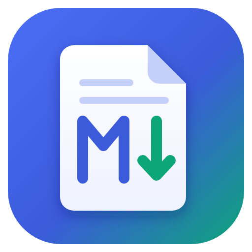

# Neo Markdown Reader

**Read Markdown the way it was meant to look.**

A fast, good-looking desktop reader for `.md` files. Double-click any Markdown file and it opens as a
clean, well-laid-out page, the way a well-designed PDF looks. You see formatted text instead of raw
symbols, and no browser tab or code editor is needed.

**[Features](#features)** · **[Install](#install-windows)** · **[Windows](#at-home-on-windows)** · **[Publishing](#publishing-and-presenting)** · **[Power features](#power-features)** · **[Shortcuts](#keyboard-shortcuts)** · **[Roadmap](ROADMAP.md)** · **[Changelog](CHANGELOG.md)** · **[License](#license)**

[](https://github.com/neogentrics/neo-markdown-reader/actions/workflows/ci.yml)


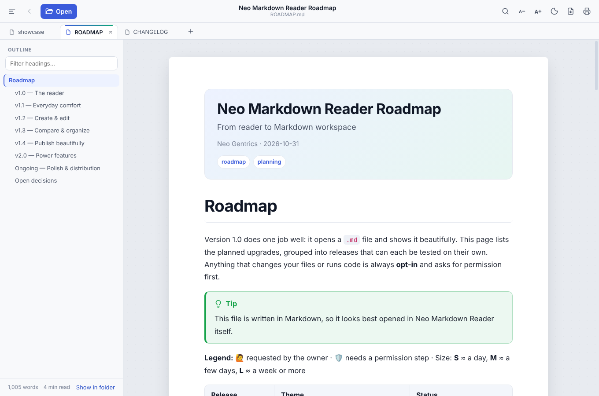

</div>

## Features

| | |
|---|---|
| **Formatted output** | Headings, tables, task lists, footnotes, definition lists, `==highlights==`, sub/superscript, emoji `:rocket:` |
| **Colors and inline HTML** | `<span style="color:…">`, `<font>`, `<div align="center">`, `<details>` collapsible sections, images side by side |
| **GitHub callouts** | `> [!NOTE]`, `[!TIP]`, `[!IMPORTANT]`, `[!WARNING]`, `[!CAUTION]` boxes |
| **Code** | Syntax coloring for 190+ languages, one-click **Copy** button, and **▶ Run** for JavaScript and Python (sandboxed, asks first) |
| **Math** | `$inline$` and `$$display$$` LaTeX via KaTeX |
| **Diagrams** | Mermaid flowcharts, sequence diagrams, Gantt charts, pie charts and more |
| **Document header** | YAML front matter (`title`, `author`, `date`, `tags`) becomes a header card at the top |
| **Outline sidebar** | Clickable table of contents that follows your scroll position, with a filter box |
| **Seven themes** | Paper, Sepia and Mist (light); Night, Forest and Dusk (dark); High Contrast; or follow Windows' setting |
| **Reading comfort** | Modern or book typeface; adjustable text size and page width; reading-progress bar |
| **Live reload** | Edit the file in VS Code / Notepad++ and the page updates when you save |
| **Export & print** | Designed PDFs, Word documents, self-contained web pages and plain text, or print it |
| **Links** | Links to other `.md` files open in the reader (with **Back**); web links open in your browser |
| **Tabs & windows** | Every file opens in a tab. Reorder by dragging; right-click for *Move to New Window*, Duplicate, Close Others; drag a tab out to split it into its own window |
| **Picks up where you left off** | Reopens your last windows and tabs, each scrolled to where you stopped reading |
| **Proper menu bar** | File, Edit, View, Tabs and Help are always visible (or auto-hide them: *View → Always Show Menu Bar*) |
| **Image viewer & rich copy** | Click any image to see it full size and zoom in; *Copy as Formatted Text* pastes into Word or email with formatting |
| **Automatic updates** | The installed app downloads new versions and offers *Restart to update* |
| **Opens your files** | Double-click, *Open with*, drag and drop, `Ctrl+O`, recent files, Windows jump list |
| **At home on Windows** *(new in 2.1)* | A formatted preview of `.md` files in File Explorer's Preview pane; a full accessibility pass (screen readers, keyboard, high contrast); a Linux `.deb`, an Intel Mac build and `winget` ([details](#at-home-on-windows)) |
| **Power features** *(2.0)* | Run JavaScript and Python code blocks in a sealed sandbox; lock documents with a password (AES-256); summarize, explain or turn notes into a report with Claude, using your own API key (optional, off by default); four more colour themes ([details](#power-features)) |
| **Publish** *(1.4)* | A PDF designer with a cover page, contents page with page numbers, headers and footers; export to Word, a single web page or plain text; present any document as full-screen slides; your own accent colour, fonts or brand stylesheet ([details](#publishing-and-presenting)) |
| **Organize** *(1.3)* | Open a whole folder, search every file in it, jump anywhere with `Ctrl+K`, read two documents side by side, compare versions, and keep private highlights, notes and bookmarks ([details](#organizing-your-documents)) |
| **Write & edit** *(1.2)* | New documents and templates; an editor beside the live preview with a formatting toolbar and spell check. Files only change after you allow it, and the original is backed up first ([details](#creating-and-editing)) |

<table>
<tr>
<td>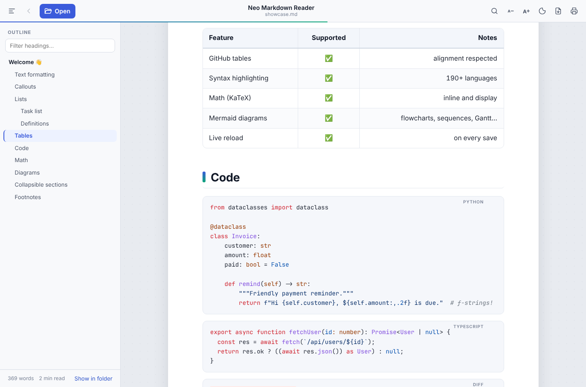</td>
<td>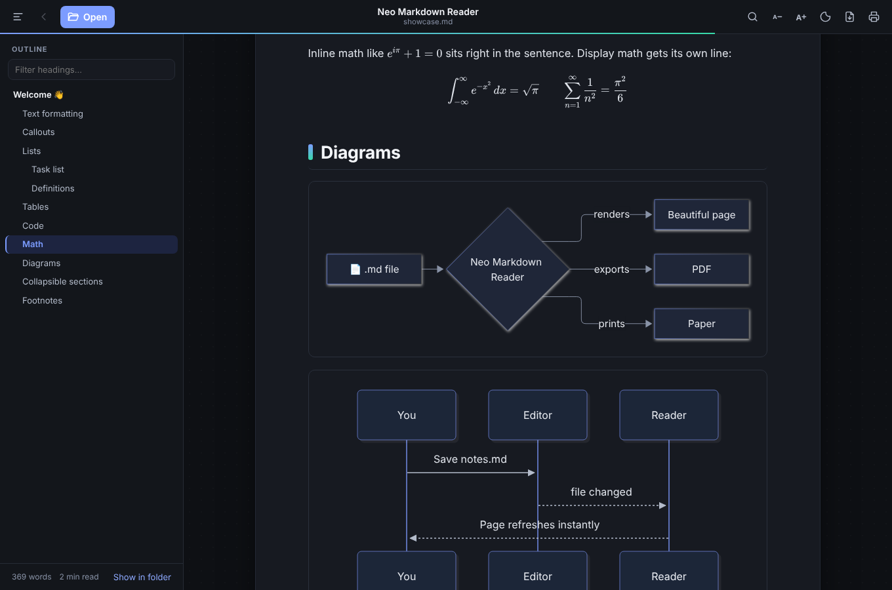</td>
</tr>
<tr>
<td align="center"><sub>Paper theme: tables and syntax-colored code</sub></td>
<td align="center"><sub>Night theme: math and Mermaid diagrams</sub></td>
</tr>
</table>

## Install (Windows)

1. Go to **[Releases](https://github.com/neogentrics/neo-markdown-reader/releases/latest)**.
2. Download one of:
   - **`NeoMarkdownReader-<version>-Setup.exe`** (recommended installer). It adds Start-menu
     and desktop shortcuts and registers the reader for `.md` files, so double-clicking any Markdown
     file opens it here.
   - **`NeoMarkdownReader-<version>-Portable.exe`**: a single file that needs no install. Run it from
     anywhere, including a USB stick.
3. Until the app is code-signed, Windows SmartScreen may say *"Windows protected your PC"*.
   Click **More info → Run anyway**.
4. The installer also adds the **File Explorer preview**: select a `.md` file in Explorer and turn on the
   Preview pane (**View → Preview pane**, or `Alt+P`) to see it formatted. The portable version doesn't
   add it.

**Make it the default for `.md` files** (if you used the portable version, or another app has taken
over): right-click any `.md` file → **Open with** → **Choose another app** → pick **Neo Markdown
Reader** → tick **Always use this app**.

**Mac and Linux** builds are on the same Releases page:
- Mac: `…-mac-arm64.dmg` for Apple silicon (M1 and later), `…-mac-x64.dmg` for Intel Macs.
- Linux: `…-linux-x86_64.AppImage` (runs anywhere) or `…-linux-amd64.deb` (Debian, Ubuntu and related).
  Install the `.deb` with:

  ```bash
  sudo apt install ./NeoMarkdownReader-<version>-linux-amd64.deb
  ```

**Updates:** from version 1.1 on, the installed app checks for new versions by itself, downloads them in the
background and offers *Restart to update*. The portable `.exe` and the Mac build tell you when a new
version is out and link to the download. *(Coming from 1.0? Install 1.1 once by hand; after that it's automatic.)*

## Creating and editing

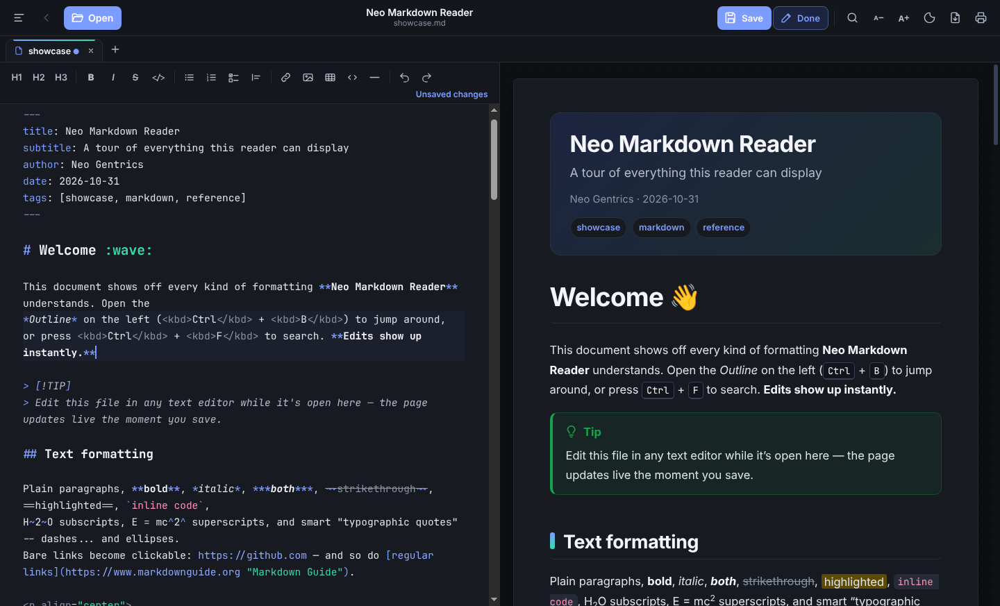

- **New document:** `Ctrl+N`, or *File → New from Template* (meeting notes, README, checklist, report with
  a title page). New documents open straight in the editor; `Ctrl+S` asks where to save them.
- **Edit a file:** click **Edit** (or `Ctrl+E`). Files always open read-only, so the first time you edit one
  the app asks: **Just this time** (the default; ends when you close the tab), **Always for this file**, or
  **Always for this folder**. Review or remove "always" choices under *Edit → Editing Permissions…*.
- **While editing:** Markdown on the left, the formatted page on the right, scrolling together. The toolbar
  adds headings, bold, lists, checklists, links, images, tables and code. Spelling mistakes are
  underlined; right-click one for suggestions. Click **Done** (or `Ctrl+E`) when you're finished.
- **Safe saving:**
  - Before the first save, the original file is copied to a backups folder (*Edit → Open Backups Folder*).
  - If another program changed the file while you were editing, the app asks before replacing those changes.
  - Windows-style line endings are kept exactly as they were.
  - Files marked read-only stay locked; use *Save As* to edit a copy.
  - Closing a tab or window with unsaved changes asks first.

## Organizing your documents

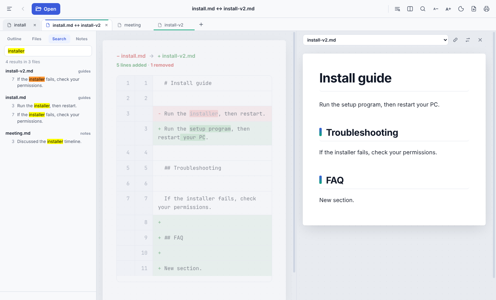

- **Open a folder** (*File → Open Folder…*, `Ctrl+Shift+O`): the sidebar's **Files** panel shows every Markdown
  file in it as a tree, with a filter box. The folder comes back the next time you open the app.
- **Find in Folder** (`Ctrl+Shift+F`): searches the text of every file in the folder. Click a result to open
  that file at the matching line.
- **Quick Open** (`Ctrl+K`): type a few letters to jump to an open tab, a bookmark, a recent file or any file in
  the folder. Start with `#` to jump to a heading in the current document.
- **Split view** (`Ctrl+\`, or right-click a tab → *Open to the Side*): two documents side by side. Choose what's
  on the right, swap sides, and turn on **linked scrolling** to move through both together.
- **Compare**: see exactly what changed between two documents: added lines in green, removed lines in red,
  changed words highlighted.
  - *Right-click a tab → Compare with…* compares two open documents.
  - *Edit → Compare with File…* compares the current document with any other file.
  - *Edit → Compare with Saved Version* shows your unsaved edits.
- **Highlights & notes:** select text and choose **Highlight** or **Add note** (`Ctrl+Shift+H`). Click a highlight
  to change its colour or note. The **Notes** panel lists them all.
  - Highlights are private: they're stored by the app, never written into the file.
  - They're found again even if the document changes around them.
- **Bookmarks:** star a file (`Ctrl+D`). Bookmarks appear at the top of the Files panel and in Quick Open.

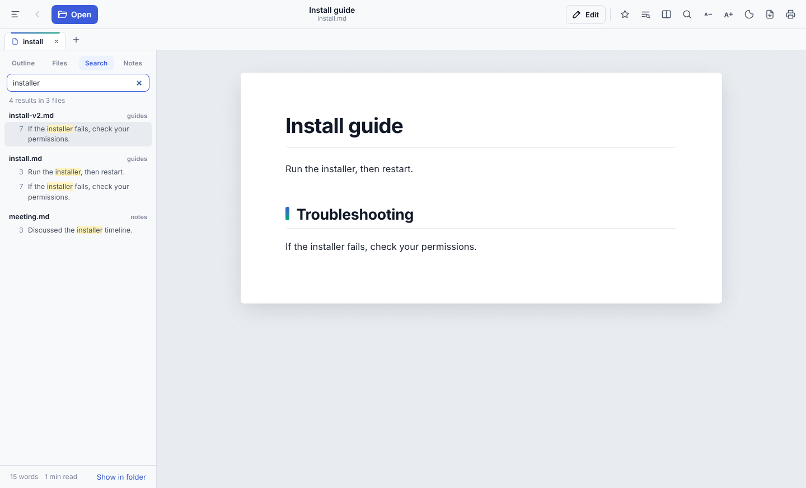

## Publishing and presenting

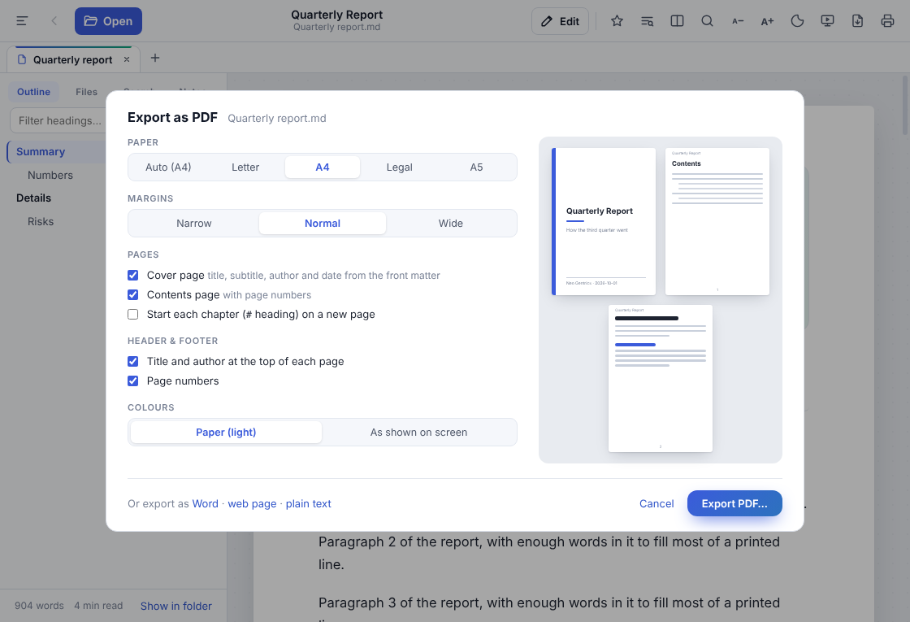

- **PDF designer** (*File → Export → PDF…*, `Ctrl+Shift+E`, or the export button):
  - Paper: Letter, A4, Legal or A5. *Auto* picks Letter in the US and Canada and A4 elsewhere.
  - Narrow, normal or wide margins.
  - A **cover page** built from the front matter (`title`, `subtitle`, `author`, `date`, `tags`,
    `organization`, `version`, and a `logo` image).
  - A **contents page** with real page numbers and clickable entries.
  - The title and author at the top of each page and page numbers at the bottom.
  - Optionally start every `#` chapter on a new page.
  - Colours: always on white paper, or the theme you read in.
  - The PDF gets bookmarks for every heading and its title, author and keywords filled in. Your choices
    are remembered.

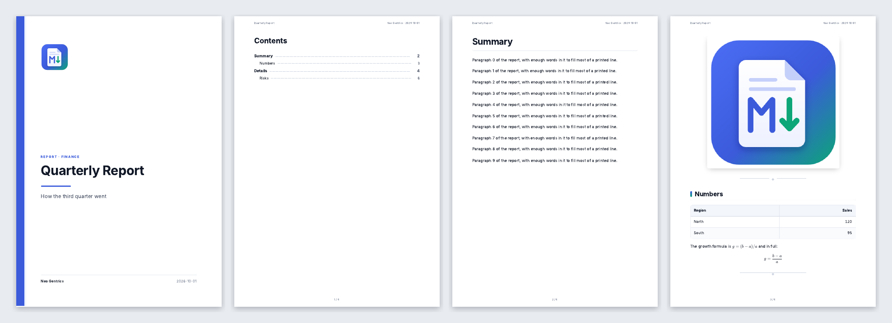

- **Other formats** (*File → Export*):
  - **Word (`.docx`):** real headings (so Word's navigation pane and table of contents work), lists, tables,
    links, images, and page numbers. Diagrams and equations become pictures.
  - **Web page (`.html`):** one file that looks like the reader's page, with images and maths fonts built in.
    It contains no scripts, so it can be emailed or put on any web server.
  - **Plain text (`.txt`):** clean, readable text with underlined headings and aligned tables.
- **Present** (*View → Present as Slides*, `Ctrl+Shift+P`, or the screen button): the document becomes full-screen
  slides.
  - Put `---` on its own line to start a new slide. Without any, slides start at each main heading.
  - The front matter becomes the title slide.
  - Use `←` `→` (or click) to move and `Esc` to leave. Text shrinks to fit a slide that holds a lot.

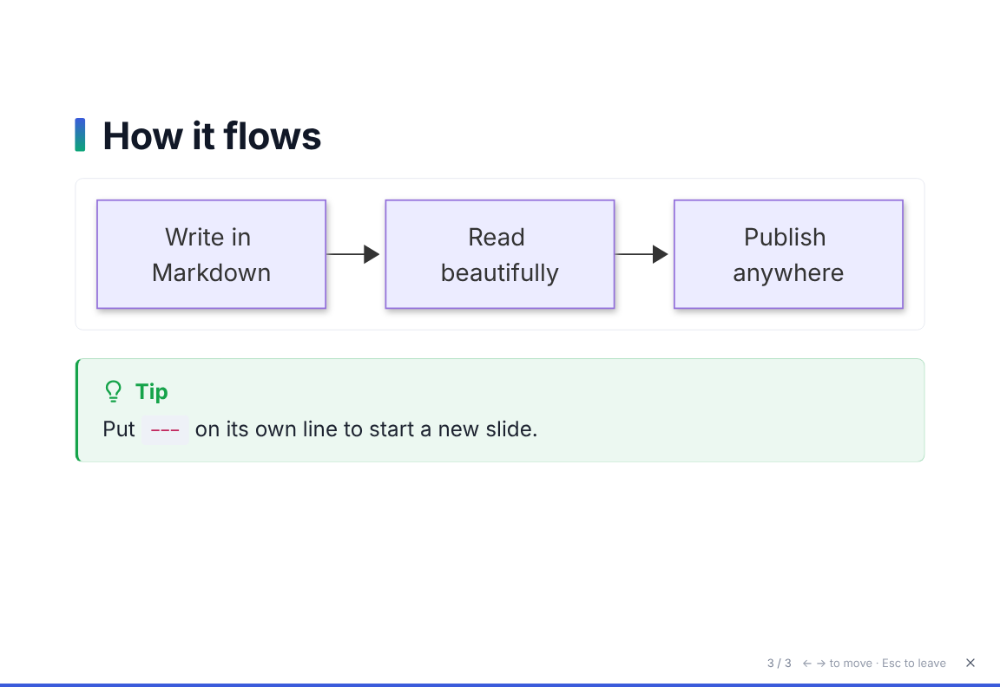

- **Customize theme** (*View → Customize Theme…*, or *Customize colours & fonts…* in the theme menu):
  - Pick an accent colour and fonts for text, headings and code. They apply to every theme.
  - Optionally choose a **brand stylesheet** (a `.css` file, such as a company house style).
  - Exports use the same look, so a PDF or web page matches what you see.

## Power features

### Run code blocks

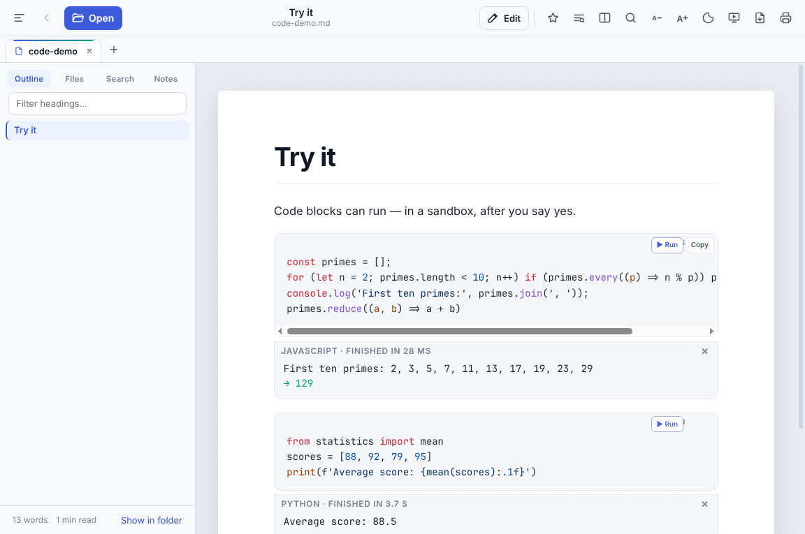

- JavaScript and Python code blocks get a **▶ Run** button, and the output appears under the block.
- **Nothing runs by itself.** Each run shows you the code and asks first. You can tick *Don't ask again
  for this document* until you close it.
- Code runs in a **sealed sandbox**: a separate hidden window with its own session. It can't read or
  change your files, use the network or see your settings, and it's stopped after 10 seconds
  (30 for Python).
- Python is the real thing ([Pyodide](https://pyodide.org)) with its standard library, built into the app.
- Shell, PowerShell and batch commands are never run.
- Turn the feature off entirely with *Edit → Allow Running Code Blocks*.

### Password-locked documents

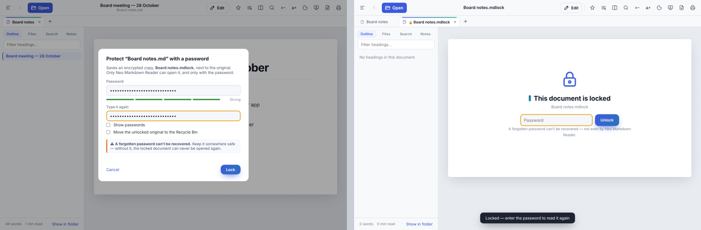

- **File → Protect with Password…** saves an encrypted copy (`notes.mdlock`) next to the original, using
  AES-256 with a key made from your password (scrypt). Only Neo Markdown Reader can open it, and only
  with the password.
- The original stays unless you tick *Move the unlocked original to the Recycle Bin*.
- Opening a locked document asks for the password. After that it stays open until you quit or choose
  **File → Lock Now**.
- You can edit a locked document. Saving keeps it encrypted.
- **File → Save an Unlocked Copy…** writes a normal `.md` where you choose.
- Locked documents are never searched, highlighted or sent to AI assist, so their text is never stored
  anywhere unencrypted.
- **A forgotten password can't be recovered.** That is what makes the lock real.

### AI assist (optional)

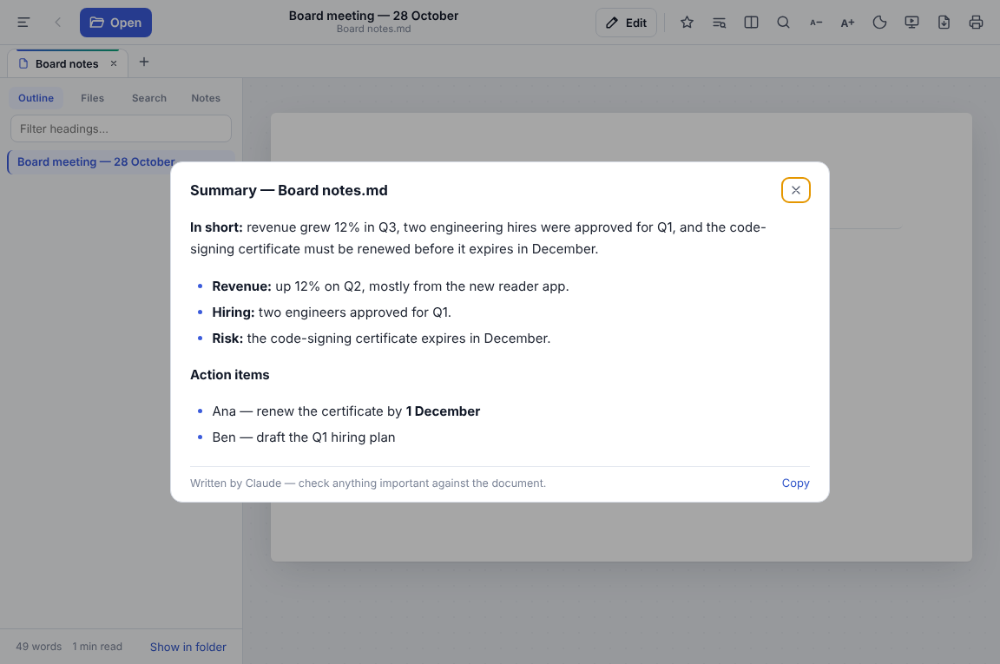

- *Edit → AI Assist* offers:
  - **Summarize Document**
  - **Explain Selection** (in plain language)
  - **Turn Notes into a Report**, which opens the draft as a new document.
- It uses Claude, with **your own Anthropic API key**, and is off until you turn it on in
  *AI Assist Settings…*. Requests are billed to your Anthropic account.
- Choose Claude Opus 5.5 (the default), Sonnet 5.5 or Haiku 5.5. Answers stream in as they're written.
- **Privacy:**
  - Nothing is sent until you pick a command.
  - Only that document, or that selection, is sent.
  - Locked documents are never sent.
- Your key is encrypted by your operating system and never stored in the settings file.

### More colour themes

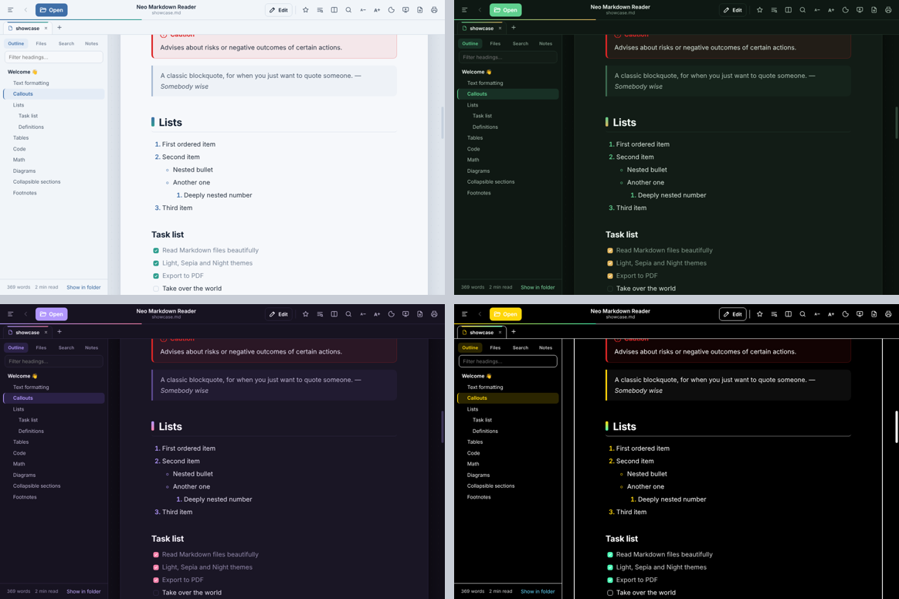

**Mist**, **Forest**, **Dusk** and **High Contrast** join Paper, Sepia and Night in the theme menu. They work
with your own accent colour and in exports.

## At home on Windows

- **File Explorer preview.** Select a `.md` file in Explorer with the Preview pane on (`Alt+P`) to see it
  formatted, without opening the app. It follows Windows' light or dark mode.
  - The preview is a quick look: it doesn't load images from the internet and doesn't run anything.
  - If another app already shows previews for `.md` files (PowerToys, for example), the installer leaves it
    in place.
  - Uninstalling the app removes the preview.
- **Accessibility:**
  - Every screen and dialog is checked automatically with [axe](https://github.com/dequelabs/axe-core) in
    all seven themes and in Windows high-contrast mode.
  - Text meets WCAG AA contrast.
  - Tabs, the sidebar and Quick Open work from the keyboard and are announced properly by screen readers.
  - Focus is always visible, and animations stop when Windows' *Animation effects* setting is off.
- **More ways to install:**
  - A Linux `.deb` package.
  - A Mac build for Intel Macs as well as Apple silicon.
  - Manifests for the Windows Package Manager (`winget`), ready to submit. Once they're accepted:

    ```bash
    winget install NeoGentrics.NeoMarkdownReader
    ```

## Keyboard shortcuts

| Keys | Action |
|---|---|
| `Ctrl` `O` | Open file (in a new tab) |
| `Ctrl` `Tab` / `Ctrl` `Shift` `Tab` | Next / previous tab |
| `←` `→` `Home` `End` / `Delete` (on a tab) | Move between tabs / close the tab |
| `Ctrl` `1` … `Ctrl` `9` | Jump to a tab |
| `Ctrl` `W` / `Ctrl` `Shift` `T` | Close tab / reopen closed tab |
| `Ctrl` + click a link | Open the linked document in a new tab |
| `Ctrl` `Shift` `C` | Copy as formatted text |
| `Ctrl` `F` | Find in document |
| `Ctrl` `B` | Show / hide the sidebar (when not editing) |
| `Ctrl` `=` / `Ctrl` `-` / `Ctrl` `0` | Bigger / smaller / reset text |
| `Ctrl` `Shift` `E` | Export as PDF (the PDF designer) |
| `Ctrl` `Shift` `P` | Present as slides (`←` `→` to move, `Esc` to leave) |
| `Ctrl` `P` | Print |
| `F5` | Reload file |
| `Alt` `←` | Back to the previous document |
| `Ctrl` `K` | Go to a file, or `#` + text to jump to a heading |
| `Ctrl` `Shift` `O` / `Ctrl` `Shift` `F` | Open folder / find in folder |
| `Ctrl` `\` | Split view |
| `Ctrl` `Shift` `H` / `Ctrl` `D` | Highlight selection / bookmark this file |
| `Ctrl` `N` | New document |
| `Ctrl` `E` | Edit / finish editing |
| `Ctrl` `S` / `Ctrl` `Shift` `S` | Save / Save As |
| `Ctrl` `B` · `Ctrl` `I` · `Ctrl` `K` | Bold · italic · link (while editing) |
| `Ctrl` `Z` / `Ctrl` `Y` | Undo / redo (while editing) |
| `Ctrl` `Shift` `N` / `Ctrl` `Shift` `W` | New window / close window |
| `F1` | Keyboard shortcuts |

On macOS use `Cmd` instead of `Ctrl`.

## Roadmap

- **v1.1** added tabs, a proper menu bar, session restore, automatic updates, an image viewer and rich copy.
- **v1.2** added new documents, templates and editing with a permission step.
- **v1.3** added folders, search across files, Quick Open, split view, Compare,
  highlights, notes and bookmarks.
- **v1.4** added a PDF designer with cover and contents pages, Word, web page and text
  export, presentation mode, and custom colours, fonts and brand stylesheets.
- **v2.0** added running code blocks in a sandbox, password-locked documents, optional AI
  assist with Claude, and four more colour themes.

- **v2.1, At home on Windows** adds a formatted preview in File Explorer, an accessibility pass, more ways to
  install (Linux `.deb`, Intel Mac, `winget`), and builds that are signed as soon as a code-signing
  certificate is added.

Next: signed installers (once a code-signing certificate is bought).

**[See the full roadmap →](ROADMAP.md)**

## Building from source

The source is public for reference. Building it for your own use or redistribution requires
permission (see [License](#license)).

Requirements: **Node.js 22** (see `.nvmrc`) and Git. Building the Windows installer also needs the
**.NET 8 SDK** and **Visual Studio or its Build Tools with "Desktop development with C++"**, for the
File Explorer preview add-on.

```bash
npm ci                 # install dependencies
npm run dev            # build the UI and launch the app with the feature showcase
npm test               # unit tests (Markdown pipeline, files, settings, editing permissions & saving)
npm run test:e2e       # launches the real app and drives it (reading, tabs, editing, folders, compare, highlights)
npm run test:preview   # File Explorer preview renderer tests (.NET 8 SDK)
npm run dist:win       # Windows installer (with the Explorer preview) + portable .exe → release/
npm run dist:mac       # macOS .dmg for Apple silicon and Intel (run on a Mac)        → release/
npm run dist:linux     # Linux AppImage + .deb                                         → release/
npm run icons          # regenerate build/icon.png + icon.ico from build/icon.svg (needs Playwright)
```

The Windows installer is built on Windows: the Explorer preview add-on is a .NET Framework library plus
a small native COM server that Windows loads it through.

## How it works

```
src/
├── main/                 Electron "main" process (Node.js, talks to the OS)
│   ├── main.js           windows, tabs bookkeeping, menus, file opening, live reload, sessions, links
│   ├── publish.js        exports: the PDF designer's pages, web pages, Word documents (runs hidden, script-free windows)
│   ├── export-tools.js   PDF finishing (pdf-lib) and .docx writing (docx), bundled into dist/export-tools.cjs
│   ├── editing.js        edit permission, saving, backups, conflict checks (the only code that writes files)
│   ├── locked.js         password-locked documents: AES-256-GCM with a scrypt key
│   ├── sandbox.js        the sealed code sandbox (own session, private scheme, every other request refused)
│   ├── ai.js             AI assist prompts and the Claude request (official Anthropic SDK)
│   ├── folders.js        scanning and searching an opened folder
│   ├── annotations.js    private highlights & notes (stored in app data, never in the file)
│   ├── updater.js        update checks against GitHub Releases (electron-updater for the installer)
│   ├── version.js        version comparison
│   ├── files.js          which files can be opened + reading them safely
│   ├── settings.js       validated user settings (theme, font, recent files, session, reading positions…)
│   └── preload.js        the small, explicit API the page may call (contextBridge)
└── renderer/             The page you see (runs in a locked-down Chromium sandbox)
    ├── markdown.js       Markdown → sanitized HTML (markdown-it + plugins, DOMPurify)
    ├── app.js            tabs, toolbar, outline, find, drag & drop, image viewer, Mermaid rendering
    ├── editmode.js       edit mode: editor beside the live preview, save / save as, new documents
    ├── editor-entry.js   the CodeMirror 6 editor (loaded only when you edit)
    ├── templates.js      File → New from Template
    ├── sidebar.js        Outline · Files · Search · Notes panels
    ├── palette.js        Quick Open (Ctrl+K)
    ├── split.js          split view and linked scrolling
    ├── compare.js        line and word diffs for Compare
    ├── highlights.js     finding and drawing highlights on the page
    ├── publish-ui.js     the PDF designer dialog and File → Export
    ├── export-model.js   the page as a simple document model (for Word and plain text)
    ├── present.js        presentation mode (slides split on ---)
    ├── brand.js          custom accent colour and fonts as CSS
    ├── theme-ui.js       View → Customize Theme
    ├── lock-ui.js        the unlock screen and File → Protect with Password
    ├── run-ui.js         ▶ Run buttons and output panels
    ├── ai-ui.js          AI assist settings and the answer panel
    ├── index.html        layout + Content-Security-Policy
    └── styles/           themes, document typography, code colors, print/PDF, export & presentation styles
└── sandbox/              The code sandbox's page and worker (plus Pyodide, copied in at build time)
preview/                    File Explorer preview: a COM preview handler (C#, .NET Framework 4.8, Markdig) + tests;
                            preview/shim is the native COM server (C++) Windows starts it through
build/installer.nsh         installer steps: registers the Explorer preview for the current user
scripts/winget-manifest.mjs writes the winget manifests for a release
scripts/build-renderer.mjs  bundles the renderer into dist/ with esbuild
samples/showcase.md         feature tour (Help → Open Feature Showcase)
test/                       node:test suites (run under jsdom)
```

**Rendering pipeline:** the file is read by the main process, sent to the page, parsed by
**markdown-it** (GitHub-flavored, with plugins for callouts, footnotes, math, emoji and more),
highlighted by **highlight.js**, sanitized by **DOMPurify**, and then decorated in the page (Mermaid
diagrams, copy buttons, outline). Relative image paths are resolved against the document's folder,
so pictures next to your `.md` file just work.

**Security model:** Markdown files can contain HTML. The reader keeps the parts that make documents
look good (colors, alignment, images, tables, `<details>`) and removes anything that could run code:
`<script>`, event handlers like `onclick`, `<iframe>`, forms and `javascript:` links. The page runs
with `sandbox`, `contextIsolation` and no Node.js access, under a strict Content-Security-Policy.
Clicking a link never executes a file: Markdown links open in the reader, web links open in your
browser, and any other local file is only *shown in its folder*. The page itself can never write a
file: saving is done by the main process, only for files you allowed, after a native permission prompt
the page can't fake. Code blocks only ever run after you confirm, in a separate sandbox with no file,
network or settings access. See [SECURITY.md](SECURITY.md).

## Releasing

1. Bump `version` in `package.json`, and update the docs for every release:
   - [CHANGELOG.md](CHANGELOG.md): a new entry.
   - This README: features table, feature sections, shortcuts, screenshots, the Roadmap summary and "How it works".
   - [ROADMAP.md](ROADMAP.md): mark what shipped and what's next.
2. Commit, then tag and push:
   ```bash
   git tag v1.0.0 && git push origin v1.0.0
   ```
   Or, without a tag: **Actions → Release → Run workflow**. It tags the current commit as
   `v<version>` from `package.json`.
3. The **Release** workflow builds Windows, macOS and Linux apps and publishes them to GitHub Releases.
4. Optional, after it's published:
   - **winget:** run `node scripts/winget-manifest.mjs`, then submit the folder it writes to
     [microsoft/winget-pkgs](https://github.com/microsoft/winget-pkgs), for example with
     `wingetcreate submit`.
   - **Code signing:** add `WINDOWS_CSC_LINK` (the `.pfx` certificate, base64-encoded) and
     `WINDOWS_CSC_KEY_PASSWORD` as repository secrets. Every later release is then signed automatically,
     and the Release log reports the signature status.

Every push and pull request runs the **CI** workflow: tests on Windows, macOS and Linux, plus a
downloadable Windows build under the run's *Artifacts*.

## License

**Proprietary. All rights reserved.** © 2026 Neo Gentrics.

The source code is visible for reference only. You may download and use the official releases. You
may **not** copy, modify, redistribute or reuse the code, in whole or in part, without written
permission. See [LICENSE](LICENSE) for the full terms and [THIRD_PARTY_NOTICES.md](THIRD_PARTY_NOTICES.md)
for the open-source components the app is built on.

For licensing enquiries: **author@neogentrics.com**
