<div align="center">

<a href="https://github.com/neogentrics/rt-markdown-reader/releases/latest">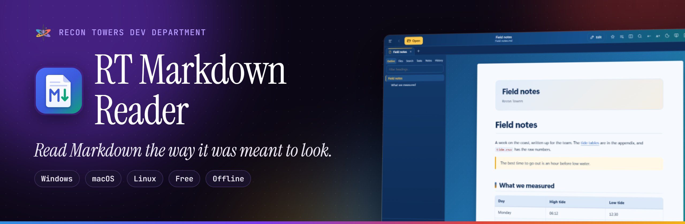</a>

<br>

[](https://github.com/neogentrics/rt-markdown-reader/releases/latest)
[](https://github.com/neogentrics/rt-markdown-reader/releases)
[](https://github.com/neogentrics/rt-markdown-reader/actions/workflows/ci.yml)
[](#install-windows)
[](LICENSE)

**[Download](https://github.com/neogentrics/rt-markdown-reader/releases/latest)** &nbsp;·&nbsp; **[Features](#features)** &nbsp;·&nbsp; **[Listen & speak](#listen--speak)** &nbsp;·&nbsp; **[Your AI](#your-ai-your-choice)** &nbsp;·&nbsp; **[Roadmap](ROADMAP.md)** &nbsp;·&nbsp; **[What's new](CHANGELOG.md)** &nbsp;·&nbsp; **[Get help](SUPPORT.md)**

</div>

<br>

Double-click any `.md` file and it opens as a clean, well-laid-out page, the way a well-designed PDF looks. You see
formatted text instead of raw symbols, with no browser tab or code editor. From there you can write, organize, publish
and listen to it, all on your own computer.

RT Markdown Reader is part of the **Recon Towers** suite, built by its Dev Department. It's free. It was called Neo
Markdown Reader until version 3.4.1.

<table>
<tr>
<td width="50%">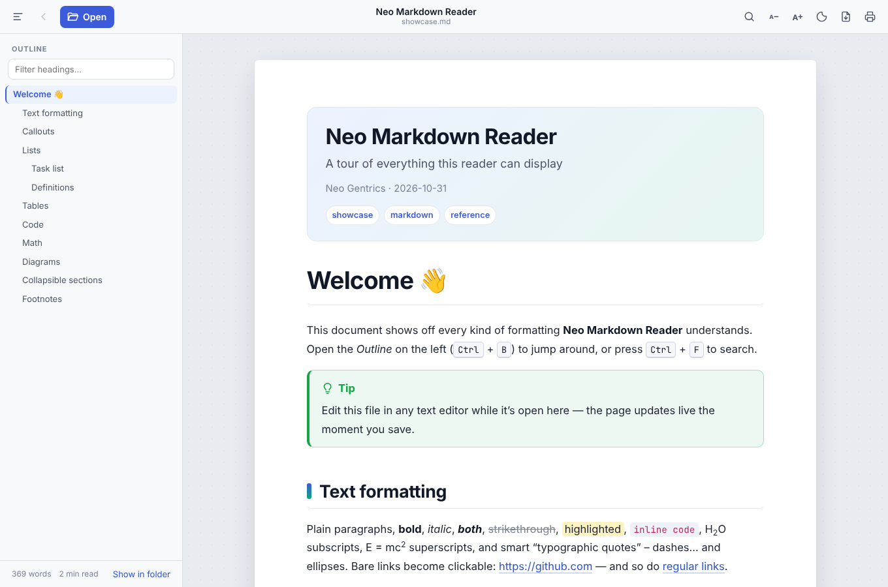<br><b>Read.</b> Clean pages, ten themes, a Glass look and fifteen fonts.</td>
<td width="50%">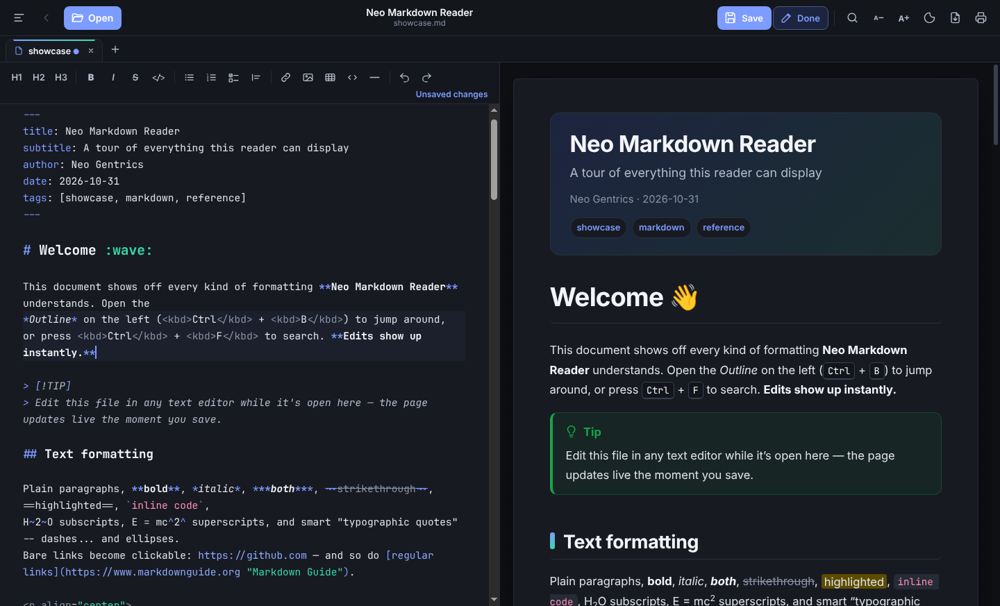<br><b>Write.</b> A side-by-side editor, dictation and AI help from the service you choose.</td>
</tr>
<tr>
<td>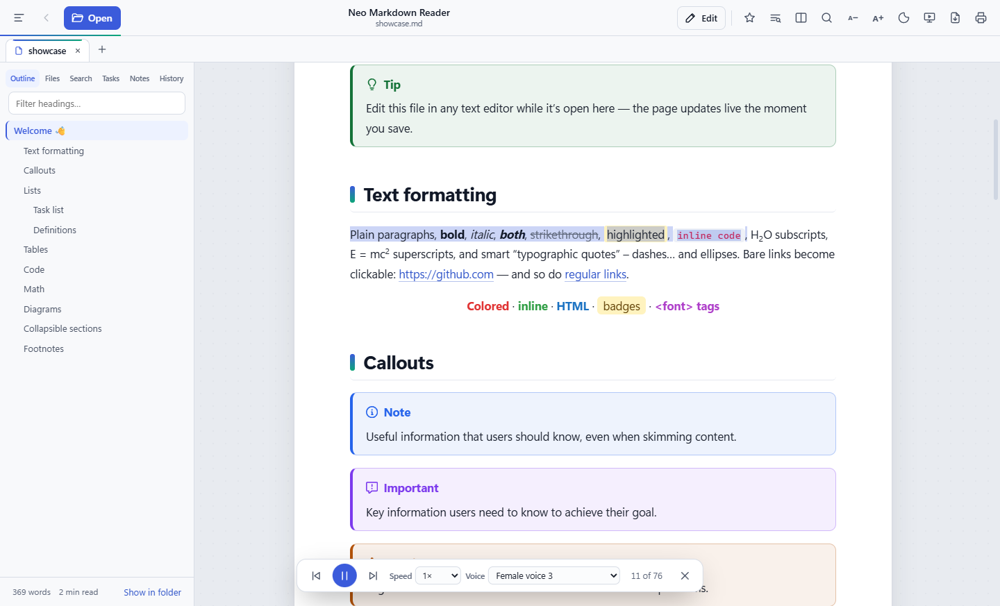<br><b>Listen.</b> Natural voices that run offline, and audiobook export with chapters.</td>
<td>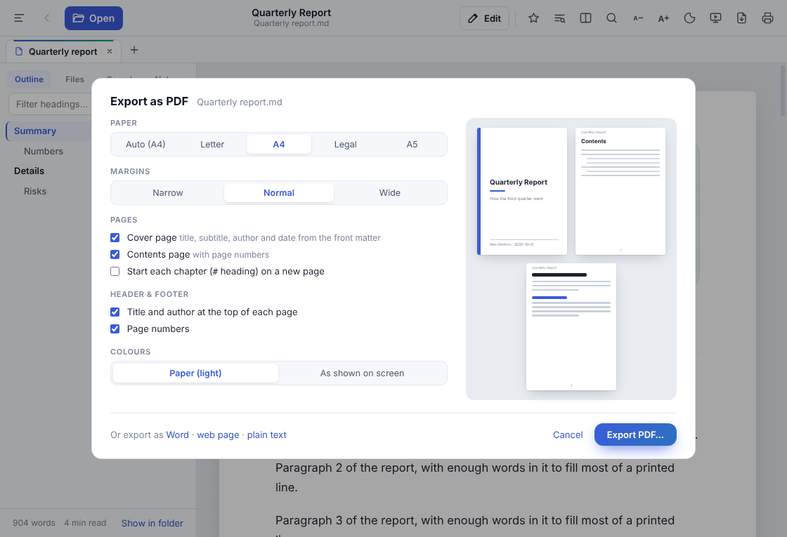<br><b>Publish.</b> Designed PDFs, Word, web pages, e-books and slides.</td>
</tr>
</table>

### Download

| Windows | macOS | Linux |
|---|---|---|
| [Installer or portable `.exe`](https://github.com/neogentrics/rt-markdown-reader/releases/latest) | [`.dmg` for Apple silicon or Intel](https://github.com/neogentrics/rt-markdown-reader/releases/latest) | [`AppImage` or `.deb`](https://github.com/neogentrics/rt-markdown-reader/releases/latest) |

The builds aren't code-signed yet, so Windows may show a SmartScreen warning the first time. See [Install](#install-windows).

## Features

| | |
|---|---|
| **Formatted output** | Headings, tables, task lists, footnotes, definition lists, `==highlights==`, sub/superscript, emoji `:rocket:` |
| **Colors and inline HTML** | `<span style="color:…">`, `<font>`, `<div align="center">`, `<details>` collapsible sections, images side by side |
| **GitHub callouts** | `> [!NOTE]`, `[!TIP]`, `[!IMPORTANT]`, `[!WARNING]`, `[!CAUTION]` boxes |
| **Code** | Syntax coloring for 190+ languages, one-click **Copy** button, and **▶ Run** for JavaScript and Python (sandboxed, asks first) |
| **Math** | `$inline$` and `$$display$$` LaTeX via KaTeX |
| **Diagrams** | Mermaid flowcharts, sequence diagrams, Gantt charts, pie charts and more |
| **Document header** | YAML front matter (`title`, `author`, `date`, `tags`) becomes a header card at the top |
| **Outline sidebar** | Clickable table of contents that follows your scroll position, with a filter box |
| **Ten themes** | Paper, Sepia and Mist (light); Blue, Red and Yellow; Night, Forest and Dusk (dark); High Contrast; or follow Windows' setting |
| **Reading comfort** | Modern or book typeface; adjustable text size and page width; reading-progress bar |
| **Live reload** | Edit the file in VS Code / Notepad++ and the page updates when you save |
| **Export & print** | Designed PDFs, Word documents, self-contained web pages and plain text, or print it |
| **Links** | Links to other `.md` files open in the reader (with **Back**); web links open in your browser |
| **Tabs & windows** | Every file opens in a tab. Reorder by dragging; right-click for *Move to New Window*, Duplicate, Close Others; drag a tab out to split it into its own window |
| **Picks up where you left off** | Reopens your last windows and tabs, each scrolled to where you stopped reading |
| **Proper menu bar** | File, Edit, View, Tabs and Help are always visible (or auto-hide them: *Preferences → General*) |
| **Image viewer & rich copy** | Click any image to see it full size and zoom in; *Copy as Formatted Text* pastes into Word or email with formatting |
| **Automatic updates** | The installed app downloads new versions; *Restart to update* installs them without any installer screens |
| **Listen & speak** *(new in 3.5)* | Export a document as an MP3 or an audiobook with chapters, dictate instead of typing, read aloud through your slides, teach the voices how to say names, and choose your speakers and microphone ([details](#listen--speak)) |
| **Linked apps** *(new in 3.6)* | Link other Recon Towers apps on your computer and send documents between them, with no accounts ([details](help/09-sync.md)) |
| **Automations** *(3.7)* | Send documents to n8n, Make, Zapier, Home Assistant or your own script, and get the answer back as a document or a change ([details](help/07-ai.md)) |
| **Notion** *(3.8)* | Bring Notion pages in as Markdown and databases as tables, send documents back with only your changes, and see when a linked page has moved on ([details](docs/notion.md)). |
| **Your home server** *(new in 3.9)* | Open a folder on Nextcloud or any WebDAV server like one on your computer, and publish documents and folders to BookStack, Wiki.js or Outline ([details](docs/home-server.md)). |
| **Smart search** *(new in 3.6)* | Find documents by what they mean, not only their exact words, with *Related documents* under the outline. Runs on your computer after a one-time download ([details](help/04-folders.md)) |
| **Citations** *(new in 3.6)* | Cite with `[@key]` from a BibTeX or CSL JSON file or Zotero, with the reference list built for you in APA, MLA, Chicago, IEEE or Harvard ([details](help/03-editing.md)) |
| **Flashcards** *(new in 3.6)* | `Q:` / `A:` lines and definitions become flashcards with spaced repetition, a quiz, and optional AI drafts from a chapter ([details](help/02-reading.md)) |
| **Your look** *(new in 3.5)* | Blue, Red and Yellow themes, a Glass look for any theme, colour-safe colours for colour blindness, and fifteen fonts |
| **Hands-on tutorial** *(new in 3.4)* | A guided tour with a practice document, offered the first time you open the app, and again from *Help → Tutorial* |
| **Help Center** *(new in 3.4)* | Press `F1` for guides, common questions and quick links, with buttons that take you straight to the setting |
| **Preferences** *(new in 3.4)* | Every setting in one window (`Ctrl+,`), so the menus stay short |
| **Work with Claude** *(new in 3.4)* | Claude Desktop and Claude Code can read your documents and suggest changes you approve, and AI assist can use your Claude Code sign-in with no API key |
| **Opens your files** | Double-click, *Open with*, drag and drop, `Ctrl+O`, recent files, Windows jump list |
| **Your AI, your choice** *(new in 3.3)* | AI assist with Claude, ChatGPT, Gemini, Mistral or OpenRouter, each with your own key, or with a private model on your own computer (Ollama, LM Studio) that needs no key and no internet; a quicker model for writing help, and a check before anything large is sent ([details](#your-ai-your-choice)) |
| **Natural voices** *(3.2)* | Read aloud in ten natural-sounding voices that run on your computer, offline, in 31 languages; downloaded once, only when you ask ([details](#natural-voices)) |
| **Across your computers** *(3.1)* | Highlights, notes, bookmarks, recent files, reading positions and settings kept the same on every computer through a folder you already sync (OneDrive, Dropbox, iCloud Drive, Google Drive), with no account ([details](#across-your-computers)) |
| **Make it yours** *(3.0)* | The app in English, Spanish, French or German (it follows your computer, or choose in *Preferences → General*); Arabic, Hebrew and other right-to-left documents read right to left; add-ons for new code-block types, export formats and colour themes, each approved by you and run in a sealed sandbox ([details](#make-it-yours)) |
| **Read, listen & share** *(2.4)* | Read aloud with your computer's voices; focus mode, folding sections and hover previews; open CSV, JSON, YAML and Jupyter notebooks; charts from a table or a `chart` block; export e-books (EPUB) and slides (PDF or PowerPoint); and (optionally) proofread, rewrite, shorten or translate a selection with Claude ([details](#read-listen--share)) |
| **Connected notes** *(2.3)* | Link documents with `[[wiki links]]` (suggested as you type, kept up to date when you rename); see what links here, a map of how a folder fits together, tags and every task in one list, a daily note, a link checker, and (optionally) ask Claude questions about a folder with links to its sources ([details](#connected-notes)) |
| **Write faster** *(2.2)* | Paste or drop pictures (saved next to the document); edit tables in a grid and paste cells from Excel; paste from Word and web pages as clean Markdown, or import a Word document; version history with compare and restore; replace across a folder with a preview and undo; run any command from `Ctrl+K` and choose your own shortcuts ([details](#writing-faster)) |
| **At home on Windows** *(2.1)* | A formatted preview of `.md` files in File Explorer's Preview pane; a full accessibility pass (screen readers, keyboard, high contrast); a Linux `.deb`, an Intel Mac build and `winget` ([details](#at-home-on-windows)) |
| **Power features** *(2.0)* | Run JavaScript and Python code blocks in a sealed sandbox; lock documents with a password (AES-256); summarize, explain or turn notes into a report with Claude, using your own API key (optional, off by default); four more colour themes ([details](#power-features)) |
| **Publish** *(1.4)* | A PDF designer with a cover page, contents page with page numbers, headers and footers; export to Word, a single web page or plain text; present any document as full-screen slides; your own accent colour, fonts or brand stylesheet ([details](#publishing-and-presenting)) |
| **Organize** *(1.3)* | Open a whole folder, search every file in it, jump anywhere with `Ctrl+K`, read two documents side by side, compare versions, and keep private highlights, notes and bookmarks ([details](#organizing-your-documents)) |
| **Write & edit** *(1.2)* | New documents and templates; an editor beside the live preview with a formatting toolbar and spell check. Files only change after you allow it, and the original is backed up first ([details](#creating-and-editing)) |

<table>
<tr>
<td>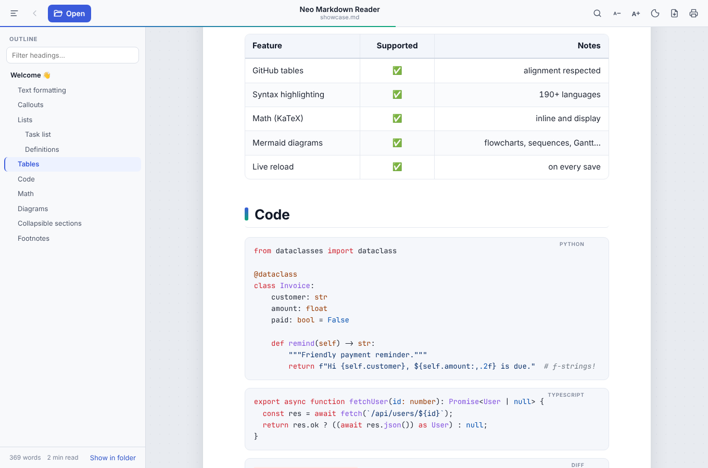</td>
<td>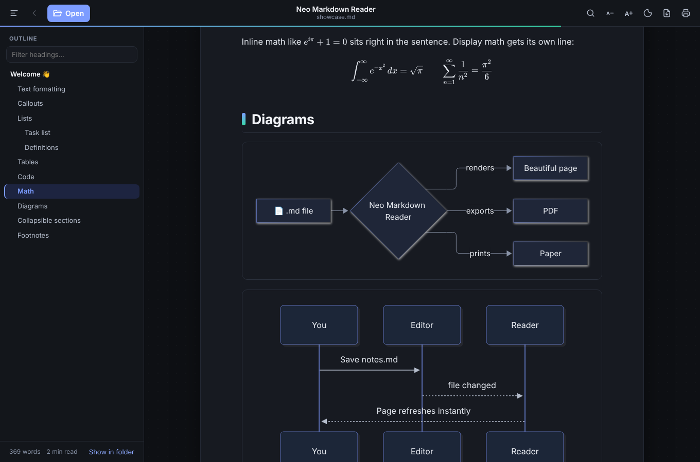</td>
</tr>
<tr>
<td align="center"><sub>Paper theme: tables and syntax-colored code</sub></td>
<td align="center"><sub>Night theme: math and Mermaid diagrams</sub></td>
</tr>
</table>

## Install (Windows)

1. Go to **[Releases](https://github.com/neogentrics/rt-markdown-reader/releases/latest)**.
2. Download one of:
   - **`RTMarkdownReader-<version>-Setup.exe`** (recommended installer). It adds Start-menu
     and desktop shortcuts and registers the reader for `.md` files, so double-clicking any Markdown
     file opens it here.
   - **`RTMarkdownReader-<version>-Portable.exe`**: a single file that needs no install. Run it from
     anywhere, including a USB stick.
3. Until the app is code-signed, Windows SmartScreen may say *"Windows protected your PC"*.
   Click **More info → Run anyway**.
4. The installer also adds the **File Explorer preview**: select a `.md` file in Explorer and turn on the
   Preview pane (**View → Preview pane**, or `Alt+P`) to see it formatted. The portable version doesn't
   add it.

**Make it the default for `.md` files** (if you used the portable version, or another app has taken
over): right-click any `.md` file → **Open with** → **Choose another app** → pick **Neo Markdown
Reader** → tick **Always use this app**.

**Mac and Linux** builds are on the same Releases page:
- Mac: `…-mac-arm64.dmg` for Apple silicon (M1 and later), `…-mac-x64.dmg` for Intel Macs.
- Linux: `…-linux-x86_64.AppImage` (runs anywhere) or `…-linux-amd64.deb` (Debian, Ubuntu and related).
  Install the `.deb` with:

  ```bash
  sudo apt install ./RTMarkdownReader-<version>-linux-amd64.deb
  ```

**Updates:** from version 1.1 on, the installed app checks for new versions by itself, downloads them in the
background and offers *Restart to update*. The portable `.exe` and the Mac build tell you when a new
version is out and link to the download. *(Coming from 1.0? Install 1.1 once by hand; after that it's automatic.)*

**Which version do I have?** *Help → About RT Markdown Reader* shows the version, what's new in it, the app's
[website](https://recontowers.com/projects/neo-markdown-reader/), where to report a problem, and *Copy Version
Details* for a bug report.

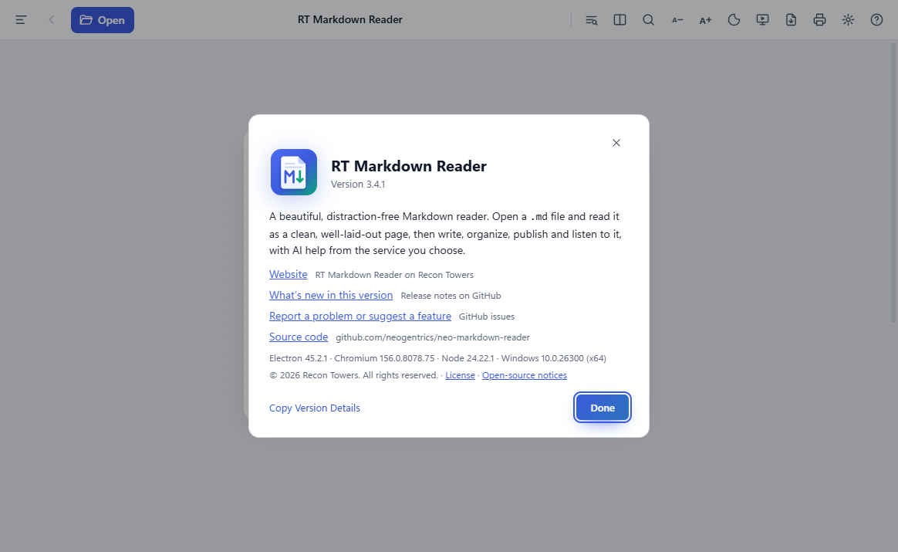

## Creating and editing


- **New document:** `Ctrl+N`, or *File → New from Template* (meeting notes, README, checklist, report with
  a title page). New documents open straight in the editor; `Ctrl+S` asks where to save them.
- **Edit a file:** click **Edit** (or `Ctrl+E`). Files always open read-only, so the first time you edit one
  the app asks: **Just this time** (the default; ends when you close the tab), **Always for this file**, or
  **Always for this folder**. Review or remove "always" choices under *Preferences → Editing*.
- **While editing:** Markdown on the left, the formatted page on the right, scrolling together. The toolbar
  adds headings, bold, lists, checklists, links, images, tables and code. Spelling mistakes are
  underlined; right-click one for suggestions. Click **Done** (or `Ctrl+E`) when you're finished.
- **Safe saving:**
  - Before the first save, the original file is copied to a backups folder (*Preferences → Editing*).
  - If another program changed the file while you were editing, the app asks before replacing those changes.
  - Windows-style line endings are kept exactly as they were.
  - Files marked read-only stay locked; use *Save As* to edit a copy.
  - Closing a tab or window with unsaved changes asks first.

## Writing faster

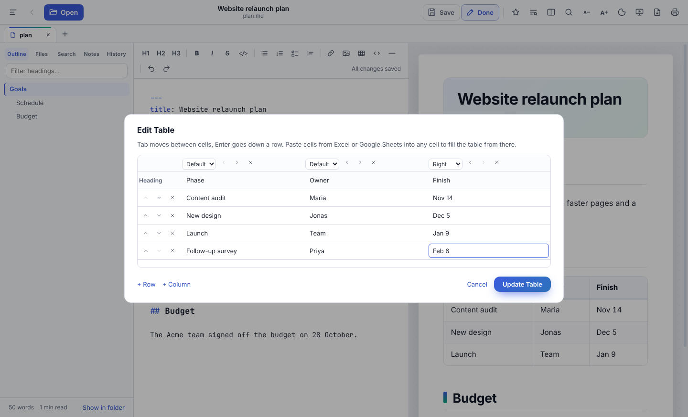

- **Pictures:** paste a screenshot (`Ctrl+V`) or drag a picture into the editor. It's saved in an `images`
  folder next to the document and linked where you dropped it, under its own name (or `pasted-` and the date
  for screenshots). An existing file is never overwritten, and only PNG, JPEG, GIF, WebP, BMP and AVIF
  pictures are accepted.
- **Tables:**
  - Click the table button (or *Edit → Edit Table…*) with the cursor in a table to edit it as a grid.
    Add, move and delete rows and columns, and set each column's alignment. The table is written back
    neatly lined up.
  - With the cursor elsewhere, the same button inserts a new table.
  - Copy cells in Excel, Google Sheets or Numbers and paste them into the editor: they become a Markdown
    table, with number columns right-aligned. Pasting cells into the grid fills it from that cell.
- **Bring content in:**
  - Paste from a web page or Word and you get clean Markdown: headings, lists, links, bold, tables.
    Scripts and hidden page parts are dropped, and pictures from the web stay linked.
  - `Ctrl+Shift+V` pastes plain text instead, and code copied from a code editor always pastes as it is.
  - *File → This Document → Import Word Document…* (or drop a `.docx` on the window) converts a Word document to a new
    Markdown file, saving its pictures in an `images` folder.
- **Version history** (`Ctrl+Shift+Y`, or the **History** panel):
  - Every save keeps the version it replaces. So do *Replace in Folder* and restoring.
  - **Compare** shows what changed since any of them. **Restore** puts one back, keeping the current
    version in History first.
  - History is kept by the app, never in your folder: every version from the last 30 days, then one a day,
    up to 1 GB in total. Locked documents' history stays encrypted.
- **Replace in Folder** (`Ctrl+Shift+R`):
  - Type what to find and what to put instead, with *Match case*, *Whole words* or a *Pattern* (a regular
    expression; `$1`, `$2`… insert captured groups).
  - **Preview changes** lists every match with the old and new text. Untick any you want to keep.
  - The app asks before changing anything. Each file is backed up and its old version kept in History
    first, and **Undo last replace** puts the whole batch back.
  - Files with unsaved edits and locked documents are left alone. A pattern that takes too long is stopped
    without freezing the app.
- **Commands and shortcuts:**
  - In Quick Open (`Ctrl+K`), type `>` to run any menu command by name (or use *Help → Find a Command…*,
    `Ctrl+Shift+K`).
  - *Preferences → Shortcuts* lets you give any command a new shortcut, remove one, or reset
    them all. If a combination is already taken, it says by what and offers to move it.

<table>
<tr>
<td>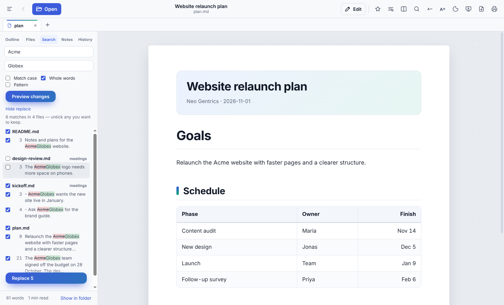</td>
<td>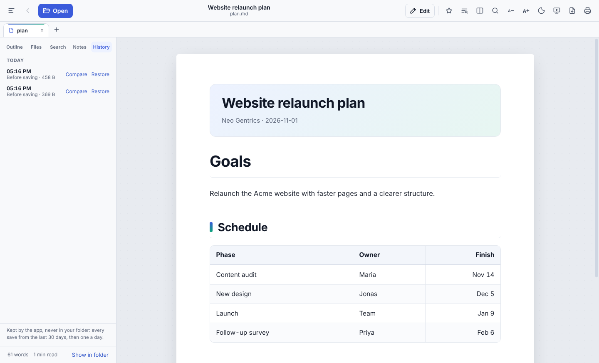</td>
</tr>
<tr>
<td align="center"><sub>Replace in Folder: preview every change, untick any to keep</sub></td>
<td align="center"><sub>Version history: compare with or restore any earlier version</sub></td>
</tr>
</table>

## Connected notes

Open a folder (*File → Open Folder…*) and its documents start working together.

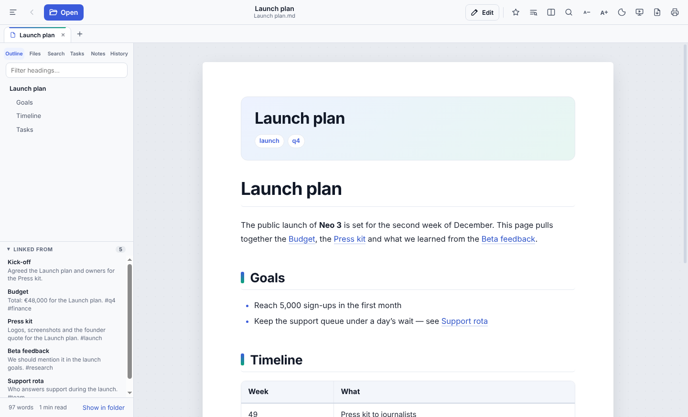

- **Wiki links:** write `[[Budget]]` to link to `Budget.md` anywhere in the folder, by its name.
  - `[[Budget#Q3]]` goes to a heading, and `[[Budget|the budget]]` shows your own text.
  - If two documents share a name, the one in the same folder wins; write `[[Projects/Budget]]` to choose.
  - A link to a document that doesn't exist yet looks faded. Click it and the app offers to create it.
  - While editing, type `[[` to pick a document from a list. Prefer links every Markdown app understands?
    Tick the option in *Preferences → Editing* and you get `[Budget](Projects/Budget.md)` instead.
- **Linked from:** the bottom of the **Outline** panel lists every document that links to the one you're
  reading, with the line around each link.
- **Rename** (`F2`, or *File → Rename…*): renames the file and offers to update every link to it in the folder,
  both `[[links]]` and ordinary `[links](paths)`. Each changed document is backed up and kept in History first.
- **Link map** (`Ctrl+Shift+M`, or the map button in the Files panel): every document as a dot and every link as a
  line, so you can see what's connected and what isn't. Click a document to open it.
- **Tags:** `#tags` in the text and `tags:` in the front matter show as chips at the top of the **Files** panel.
  Click one to see only those files.
- **Tasks** (`Ctrl+Shift+L`, the **Tasks** panel): every `- [ ]` checklist item in the folder in one list —
  overdue first, then today, upcoming and undated.
  - Give a task a date with `📅 2026-11-20`, `due: 2026-11-20` or `@due(2026-11-20)`.
  - Tick it off in the list and the file is changed for you (the app asks for permission first, as always).
- **Today's note** (`Ctrl+Shift+D`, or *File → Today's Note*): opens `Daily/2026-11-02.md` in the folder,
  creating it from a simple template the first time each day.
- **Check links** (*Edit → Check Links in Folder…*): finds links to documents, headings, pictures and files that
  don't exist, and opens each one at its line.
- **Ask about this folder** (*AI Assist → Ask About This Folder…*, optional): ask a question and Claude answers
  from the documents you tick, citing each point as a link (`Budget.md:6`) that opens that line. Only the ticked
  documents are sent, with your own API key, and locked documents are never included.

<table>
<tr>
<td>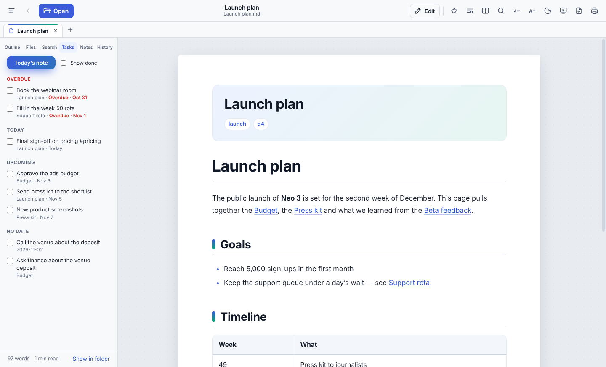</td>
<td>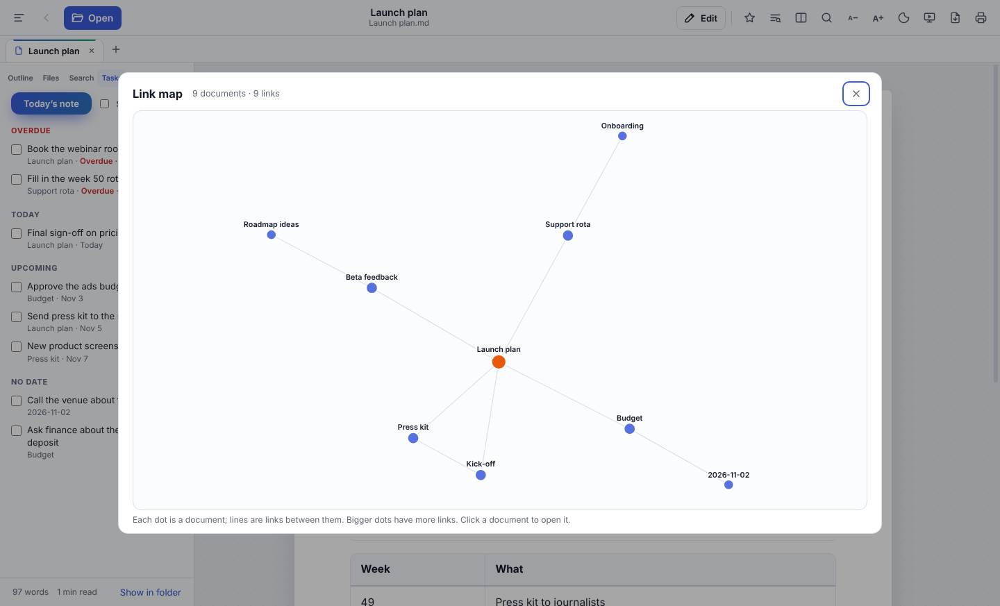</td>
</tr>
<tr>
<td align="center"><sub>Every task in the folder, overdue first</sub></td>
<td align="center"><sub>The link map: how the folder fits together</sub></td>
</tr>
</table>

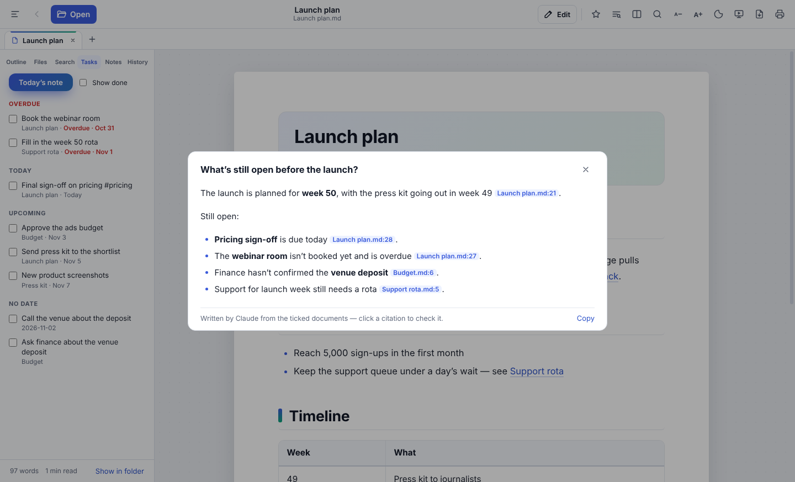

## Read, listen & share

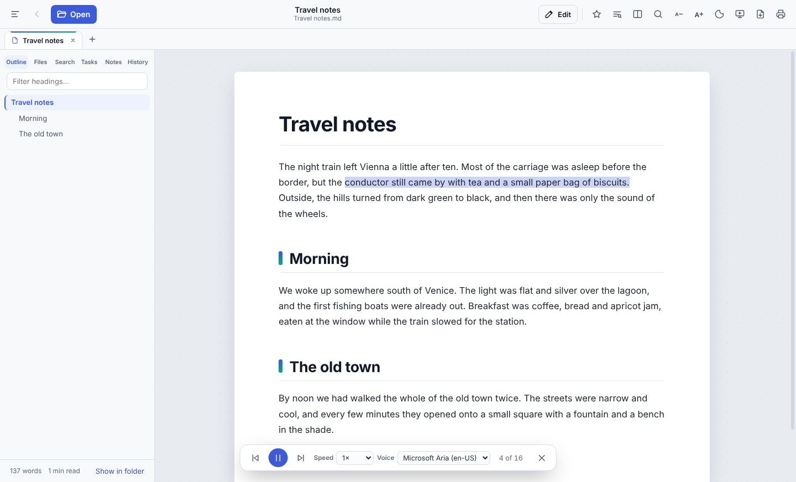

- **Read aloud** (*View → Read Aloud*, `Ctrl+Shift+U`): the document is read with your computer's own voices,
  one sentence at a time, each highlighted as it's read.
  - It starts at the sentence you selected, or the first one on screen.
  - Pause, skip to the next or previous section, change the speed (0.75× to 2×) or the voice. `Esc` stops.
  - Code, equations and diagrams are skipped. It works offline: only voices on your computer are offered,
    so the text never leaves it. (On Linux, install `speech-dispatcher` and a voice such as `espeak-ng`.)
  - For a voice that sounds like a person, choose a [natural voice](#natural-voices) in the same list.
- **Focus mode** (`F8`): everything except the paragraph you're reading fades back.
- **Folding sections:** point at a heading and click the arrow beside it to fold its section away. Use
  *View → Sections → Fold All* (`Ctrl+Shift+[`) to fold everything and see the document's shape.
  - Going to a heading from the outline, a link or a search opens its section again.
  - Exports and printing always include everything.
- **Hover previews:** point at a footnote number to read the note. Point at a link to another document to see
  the start of it, or of the section it links to.
- **More file types**, opened read-only (*File → Open*, drag and drop, or a link):
  - **CSV and TSV** as a table. Click a column heading to sort by it; numbers sort as numbers.
  - **JSON and YAML** formatted and coloured.
  - **Jupyter notebooks** (`.ipynb`) with their text, code and the outputs saved in the file. Nothing is run.
  - Like any document, they can be searched, printed and exported.
- **Charts from data:** a table becomes a bar, line or pie chart in the theme's colours. Write
  `<!-- chart: bar -->` on the line before the table (it stays below the chart), or put the data in a
  `chart` block:

  ````markdown
  ```chart
  type: line          (bar, line or pie)
  title: Weekly sign-ups
  Week, Web, App
  1, 310, 120
  2, 365, 160
  ```
  ````

  Charts are included in PDF, Word, web page, e-book and slide exports.
- **E-books and slides** (*File → Export*):
  - **E-book (.epub)** for Apple Books, Kobo, Google Play Books and most e-readers. It has a chapter for each
    main section, a table of contents, and its pictures and diagrams.
  - **Slides as PDF:** each slide on a 16:9 page, exactly as in presentation mode.
  - **Slides as PowerPoint (.pptx):** editable text, with pictures, tables, charts and diagrams. Slides are
    split the same way as presentation mode: at `---` lines, or at the main headings.
- **AI writing help** (optional): select text in the editor, then choose *AI Assist → Proofread, Rewrite,
  Shorten* or *Translate…* (also on the editor's right-click menu).
  - Claude's suggestion appears as a change: removed words struck through, new ones highlighted.
  - Nothing changes until you click **Accept**, and one `Ctrl+Z` undoes it.
  - Only the selection and a little of the text around it are sent.

<table>
<tr>
<td>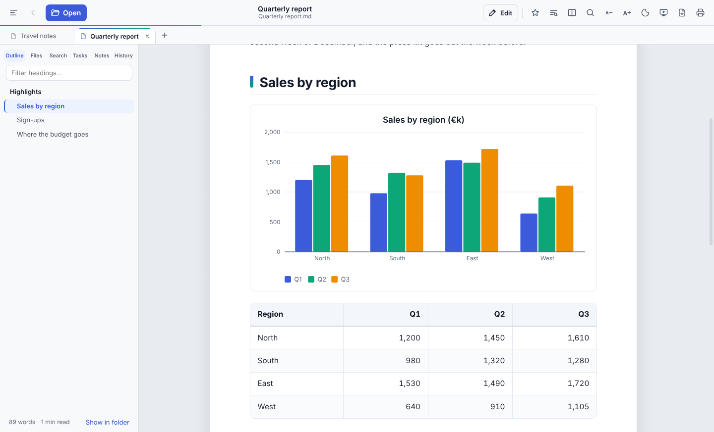</td>
<td>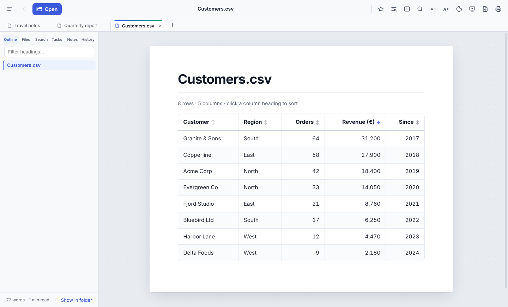</td>
</tr>
<tr>
<td align="center"><sub>A chart from a table, in the theme's colours</sub></td>
<td align="center"><sub>A CSV file, sorted by any column</sub></td>
</tr>
</table>

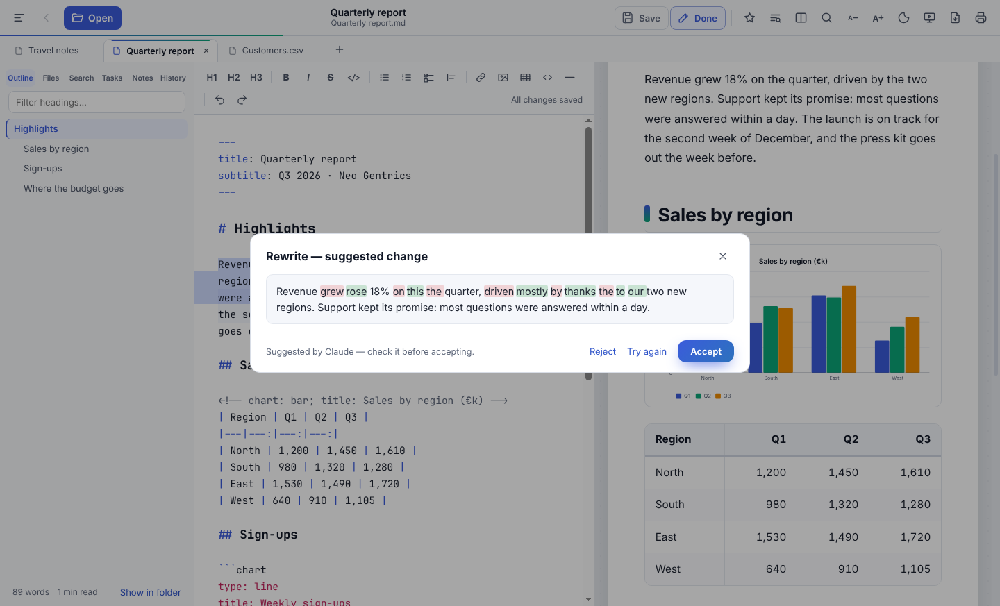

## Work with Claude

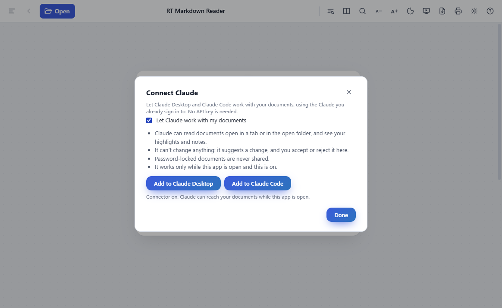

*New in 3.4.* Use the Claude you already sign in to, with no API key:

- **Connect Claude** (*Preferences → AI and Claude*): turn it on, then click **Add to Claude Desktop** or
  **Add to Claude Code**. Claude can then list your open documents, read them, search your open folder, and see
  your highlights and notes.
- **Changes stay yours.** Claude can't write to a file. It suggests a change, and you see it marked up in the app
  to accept or reject. Accepting asks for edit permission as usual, and keeps a backup and a History copy.
- **What Claude can't reach:** password-locked documents, and anything that isn't open in a tab or in the open
  folder. It works only while the app is open and the connector is on.
- **AI assist through Claude Code:** in *AI Assist Settings…*, choose *Claude Code (your sign-in, no key)*. Requests
  use your Claude plan, and Claude Code runs with every tool switched off, so it can only write text back.
- ***File → Open Folder in Claude Code*** opens a terminal in the document's folder, running Claude Code.

The portable version moves each time it runs, so use the installed app for the connector.

## Help and settings

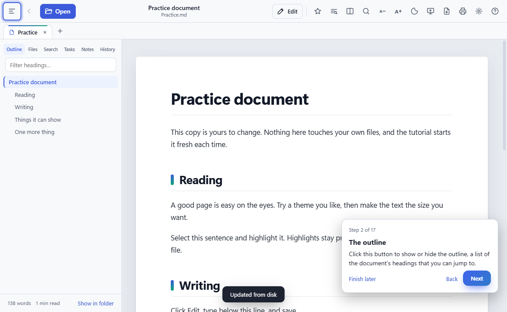

*New in 3.4.* The first time you open the app, including after updating from an older version, it offers a
hands-on tour. Steps move on when you've done what they say, on a practice copy, so your own files aren't touched.
Stop at any time and pick up where you left off, or take it again from the Help Center.

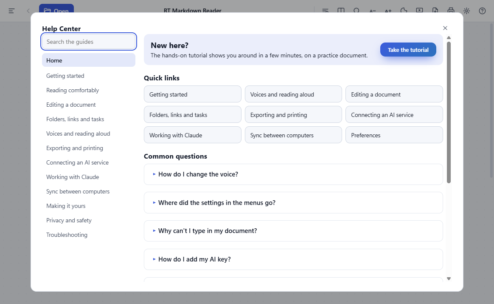

The **Help Center** (`F1`, or the **?** button) is the app's own guide. Its home page has the tutorial, quick links
and common questions, and the guides can take you straight to the setting they describe. You can search them all.
The guides are in English for now.

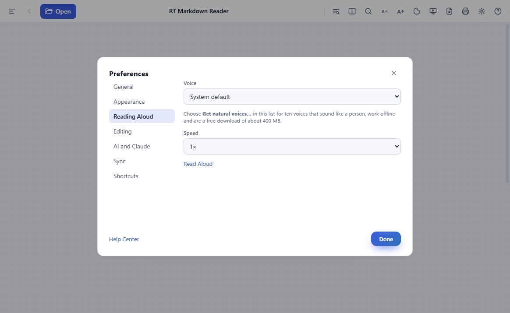

**Preferences** (`Ctrl+,`, or the gear button) has every setting in one window: language, appearance, voices,
editing, AI and Claude, sync and shortcuts. Simple choices are made there, and larger ones open their own window.
Anything that moved out of the menus keeps its shortcut, and *Find a Command* (`Ctrl+Shift+K`) still finds it.

## Your AI, your choice

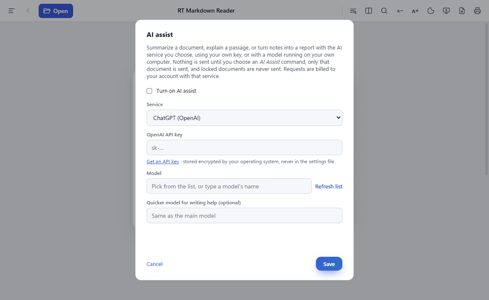

AI assist (summaries, explanations, reports, *Ask About This Folder…* and writing help) now works with the
service you already use. Choose it in *Preferences → AI and Claude*:

| Service | What you need |
|---|---|
| **Claude** (Anthropic) | An Anthropic API key. Opus 5.5 by default, or Sonnet 5.5 or Haiku 5.5. |
| **ChatGPT** (OpenAI) | An OpenAI API key. |
| **Gemini** (Google) | A Gemini API key from Google AI Studio. |
| **Mistral** | A Mistral API key. |
| **OpenRouter** | One OpenRouter key for hundreds of models from many companies. The model list shows each one's price. |
| **On this computer** | [Ollama](https://ollama.com) or [LM Studio](https://lmstudio.ai) running on your computer, or any server that speaks the OpenAI format. No key, and **nothing leaves your computer**. |

- **Models come from the service itself.** *Refresh list* asks the service which models your key can use, so
  new models show up without an app update. You can also type a model's name.
- **A quicker model for writing help.** Proofread, rewrite, shorten and translate can use a faster, cheaper
  model, while summaries, reports and questions about a folder use the main one.
- **Big requests ask first.** Before sending more than about 50,000 tokens (roughly 200,000 characters) to a
  paid service, the app says how big it is, with the price when the service publishes one (OpenRouter does).
- **Each service keeps its own key.** Keys are encrypted by your operating system and never stored in the
  settings file. Switching services doesn't lose a key, and *Remove saved key* removes only that one. Your
  Claude key from an earlier version carries over.
- **A server on your own network:** plain `http://` addresses work only for this computer or your own network
  (such as `http://192.168.1.20:11434/v1`); anywhere else needs `https://`, so your documents never cross the
  internet unencrypted.

To use a model on your computer with Ollama: install it, run `ollama pull llama3.2` (or any model), then choose
*On this computer* and *Refresh list*.

## Across your computers

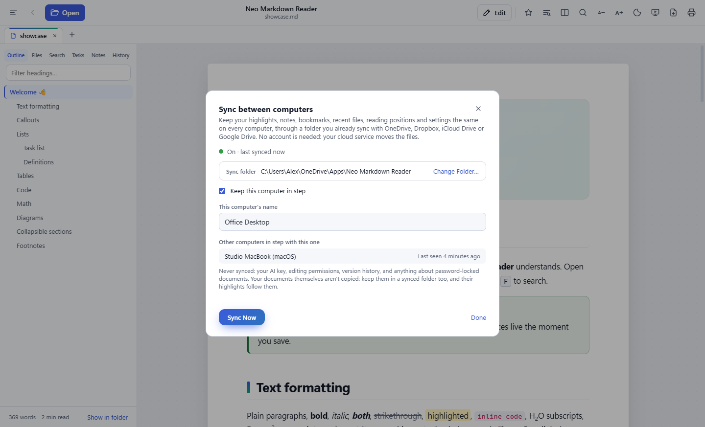

Read on one computer, pick up on another. *Preferences → Sync* keeps these the same everywhere:

- your **highlights and notes**,
- how your **flashcards** are going,
- your **bookmarks**, **recent files** and **where you stopped reading** in each document,
- your **settings**: theme, typeface, text size, page width, language, read-aloud speed and voice, export
  choices, your own colours and fonts, and your keyboard shortcuts.

**Setting it up:** on each computer, open *Preferences → Sync* and choose the same folder inside
OneDrive, Dropbox, iCloud Drive or Google Drive (the app offers the cloud folders it finds). That's all: no
account, no server, no sign-in. The app keeps its files in a *RT Markdown Reader* folder inside the one you
choose, and your cloud service carries them between computers.

**How it stays out of trouble:**
- Each computer writes only its own file, so the cloud service never has two versions of one file to choose
  between and never makes "conflicted copy" files. Every computer reads all of them and keeps the newest
  version of each highlight, note and setting; removing something removes it everywhere.
- Your documents aren't copied. Keep them in a synced folder too, and their highlights follow them: a document
  is recognised by where it sits inside your cloud folder, even though its full path is different on each
  computer. A highlight for a document that hasn't finished downloading waits for it.
- A computer that joins later takes on the settings already in use instead of overwriting them.
- **Never synced:** your AI keys, editing permissions, version history, the *Allow Running Code Blocks*
  setting, and anything about password-locked documents (a highlight quotes the text it marks).

## Natural voices


Your computer's built-in voices can sound flat and robotic. Since 3.2, *Read aloud* can use **natural
voices** instead: ten of them, five female and five male, that sound like someone reading to you.

- **Getting them:** open *Read aloud* (`Ctrl+Shift+U`), open the voice list and choose *Get natural
  voices…*. The app says how big they are (about 400 MB) and what license they come under, and downloads
  nothing until you agree. They download once.
- **Offline and private:** every sentence is made on your computer. Nothing you read is sent anywhere, and
  they work without an internet connection.
- **Smooth:** each sentence is made in the background while the one before it is read, so there are no
  pauses between sentences. A slower computer automatically gets a slightly faster setting.
- **Languages:** English, Spanish, French and German, and 27 more (Arabic, Dutch, Hindi, Italian, Japanese,
  Korean, Polish, Portuguese, Russian, Swedish, Turkish, Ukrainian, Vietnamese…). The language comes from
  the document's front matter (`lang: es`) or is recognised from its words. A language the natural voices
  don't speak yet is read by your computer's own voice.
- **Removing them:** *Remove natural voices…* at the end of the same list deletes the download. Your
  computer's own voices are always there, and are still the default.

The voices are [Supertonic 3](https://github.com/supertone-inc/supertonic) by Supertone, under the
[OpenRAIL-M license](https://huggingface.co/supertone-oss-archive/supertonic-3/blob/aafc6e32416a594460b32413efc49d7fe4ce6d46/LICENSE),
which forbids using them to impersonate people, to deceive or to harm anyone. They come from one fixed
version of Supertone's published model, and each file is checked against its published size and SHA-256
checksum before it's used.

## Listen & speak

*New in 3.5.* Everything here runs on your computer, and works offline.

**Export as audio.** *File → Export → Audio (MP3 or Audiobook)…* has the natural voices read the whole document. An
MP3 is one file; an audiobook (`.m4b`) has a chapter for each main heading. It uses your reading speed and
pronunciation list, and runs in the background, with its progress in the corner of the window. A long book can take
hours. Audiobooks need an AAC encoder, which Linux doesn't have, so Linux offers MP3 only.

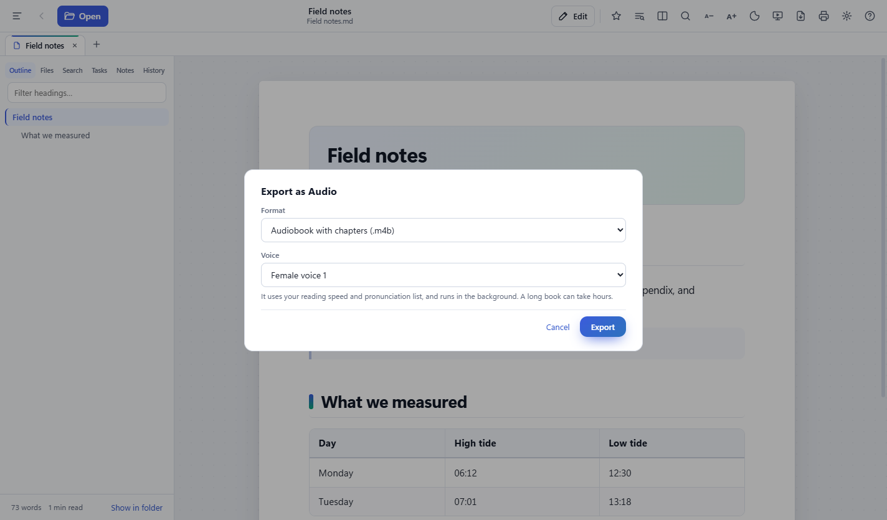

**Dictation.** While editing, press `Ctrl+Alt+D` or the microphone button, and speak. Words appear at the cursor at
each pause. It uses the document's language, or your computer's. The Whisper model is about 80 MB, downloaded once
when you first use it and checked against its published SHA-256. What you say never leaves your computer.

**Read aloud in slides.** Press `R` in a presentation. Reading marks each sentence and turns the slides by itself. Move
to another slide and the reading comes with you. Leave the slides and it carries on in the document.

**The pronunciation list.** *Preferences → Reading Aloud → Pronunciation List…* lets you spell a word the way it sounds,
and read aloud says it that way. Use one list for every document, or one for a folder and the folders inside it. The
lists are kept in the app's own data, so nothing is added to your folders.

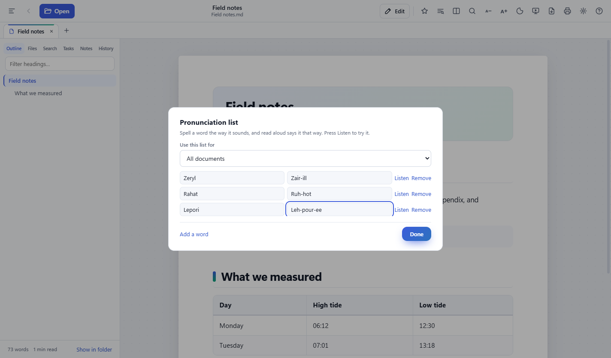

**Speakers and microphone.** Choose them in *Preferences → Reading Aloud*. The speaker choice works with the natural
voices, because the app plays those itself. The computer plays its own voices, so they always use its default device.

**The bar.** Drag the read-aloud bar anywhere in the window, by its handle or any empty part of it, and it stays there.
Double-click it to put it back.

## Make it yours

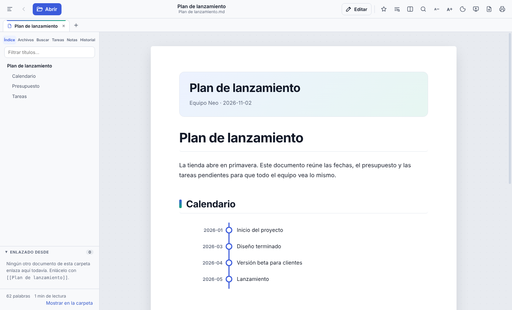

- **The app in your language:** English, Spanish (Español), French (Français) or German (Deutsch).
  - It follows your computer's language. To choose another, use *Preferences → General*; the change is immediate.
  - Menus, buttons, dialogs, messages and the shortcut list are translated. Your documents, file names and
    notes are always shown exactly as written.
- **Right-to-left documents:** Arabic, Hebrew, Persian, Urdu and other right-to-left text reads right to left.
  - Each paragraph, heading and list item follows its own text, so a document can mix languages.
  - Lists, quotes and tables that start in a right-to-left language turn as a whole: bullets on the right,
    the first column on the right.
  - To turn a whole document, add `lang: ar` (or `he`, `fa`, `ur`…) or `dir: rtl` to its front matter.
  - The outline, PDF, Word, web page and e-book exports keep the direction.
- **Add-ons** (*Preferences → Appearance*): an add-on is a small package (`.nmraddon`) that can add:
  - **code-block types:** for example, a `timeline` block that's drawn as a picture;
  - **export formats** (in *File → Export*): for example, an outline (OPML) for mind-map apps;
  - **colour themes** (in *Preferences → Appearance*), built on the light or dark theme.

  Before an add-on is installed, the app shows what it will add, and nothing is installed until you agree.
  Its code runs in the same sealed sandbox as ▶ Run: it can't use the internet, read your files or change your
  documents. What it draws is cleaned like any document, and it can't load anything from the web. Themes are
  colours only, and one that would be hard to read (below WCAG AA contrast) is refused. Turn an add-on off or
  remove it in the same window. To write one, see [docs/addons.md](docs/addons.md); a complete example is in
  [samples/addons/neo-extras](samples/addons/neo-extras).

<table>
<tr>
<td>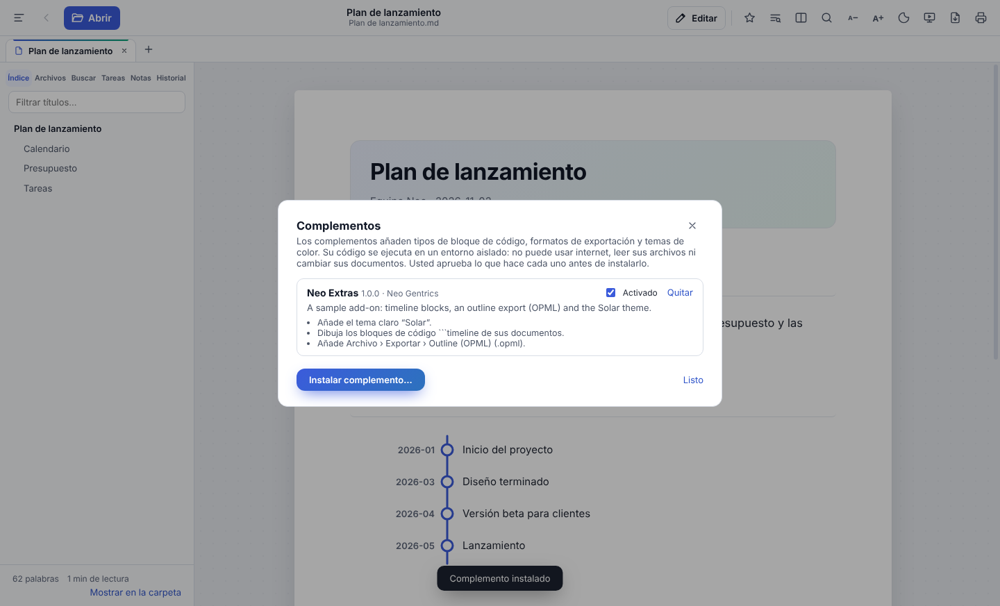</td>
<td>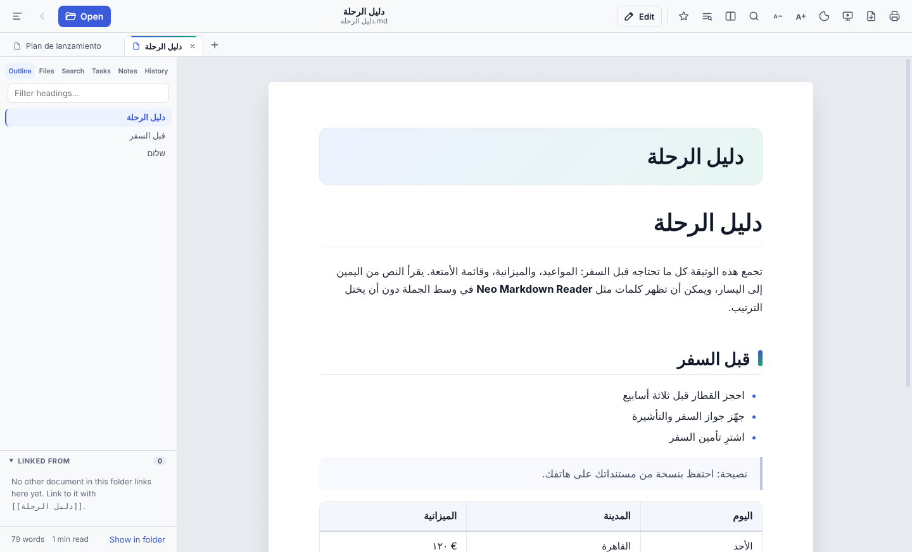</td>
</tr>
<tr>
<td align="center"><sub>The Add-ons window, and a timeline drawn by an add-on</sub></td>
<td align="center"><sub>An Arabic document, right to left</sub></td>
</tr>
</table>

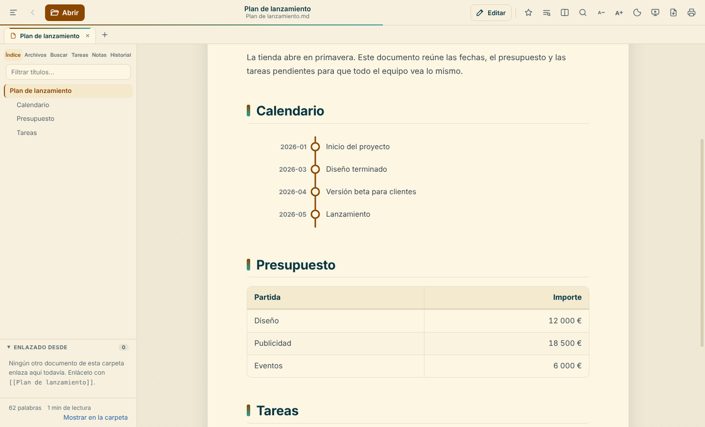

## Organizing your documents

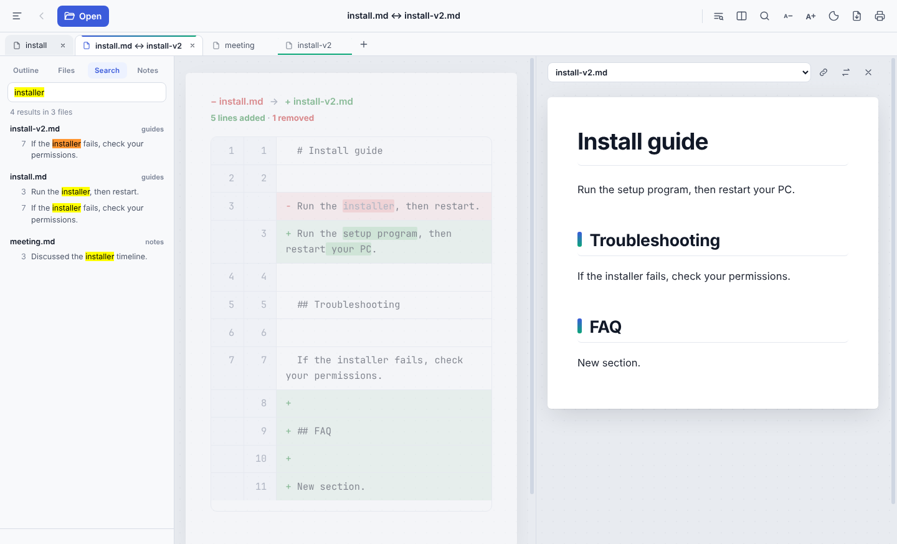

- **Open a folder** (*File → Open Folder…*, `Ctrl+Shift+O`): the sidebar's **Files** panel shows every Markdown
  file in it as a tree, with a filter box. The folder comes back the next time you open the app.
- **Find in Folder** (`Ctrl+Shift+F`): searches the text of every file in the folder. Click a result to open
  that file at the matching line.
- **Quick Open** (`Ctrl+K`): type a few letters to jump to an open tab, a bookmark, a recent file or any file in
  the folder. Start with `#` to jump to a heading in the current document.
- **Split view** (`Ctrl+\`, or right-click a tab → *Open to the Side*): two documents side by side. Choose what's
  on the right, swap sides, and turn on **linked scrolling** to move through both together.
- **Compare**: see exactly what changed between two documents: added lines in green, removed lines in red,
  changed words highlighted.
  - *Right-click a tab → Compare with…* compares two open documents.
  - *Edit → Compare and History → Compare with File…* compares the current document with any other file.
  - *Edit → Compare and History → Compare with Saved Version* shows your unsaved edits.
- **Highlights & notes:** select text and choose **Highlight** or **Add note** (`Ctrl+Shift+H`). Click a highlight
  to change its colour or note. The **Notes** panel lists them all.
  - Highlights are private: they're stored by the app, never written into the file.
  - They're found again even if the document changes around them.
- **Bookmarks:** star a file (`Ctrl+D`). Bookmarks appear at the top of the Files panel and in Quick Open.

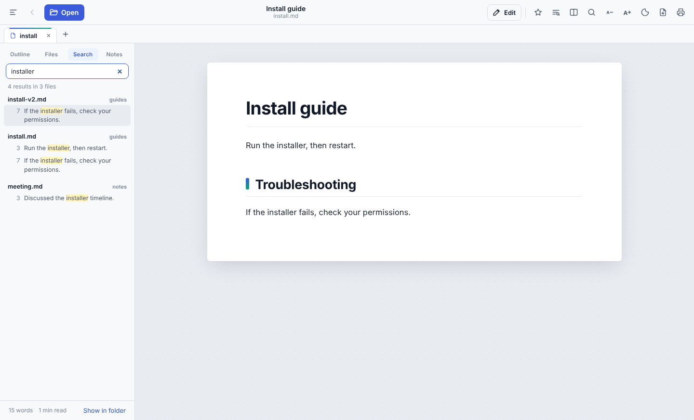

## Publishing and presenting


- **PDF designer** (*File → Export → PDF…*, `Ctrl+Shift+E`, or the export button):
  - Paper: Letter, A4, Legal or A5. *Auto* picks Letter in the US and Canada and A4 elsewhere.
  - Narrow, normal or wide margins.
  - A **cover page** built from the front matter (`title`, `subtitle`, `author`, `date`, `tags`,
    `organization`, `version`, and a `logo` image).
  - A **contents page** with real page numbers and clickable entries.
  - The title and author at the top of each page and page numbers at the bottom.
  - Optionally start every `#` chapter on a new page.
  - Colours: always on white paper, or the theme you read in.
  - The PDF gets bookmarks for every heading and its title, author and keywords filled in. Your choices
    are remembered.

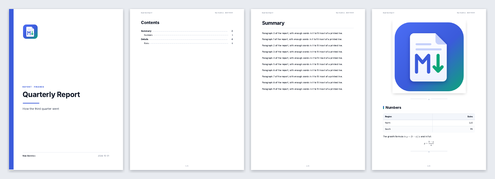

- **Other formats** (*File → Export*):
  - **Word (`.docx`):** real headings (so Word's navigation pane and table of contents work), lists, tables,
    links, images, and page numbers. Diagrams and equations become pictures.
  - **Web page (`.html`):** one file that looks like the reader's page, with images and maths fonts built in.
    It contains no scripts, so it can be emailed or put on any web server.
  - **Plain text (`.txt`):** clean, readable text with underlined headings and aligned tables.
- **Present** (*View → Present as Slides*, `Ctrl+Shift+P`, or the screen button): the document becomes full-screen
  slides.
  - Put `---` on its own line to start a new slide. Without any, slides start at each main heading.
  - The front matter becomes the title slide.
  - Use `←` `→` (or click) to move and `Esc` to leave. Text shrinks to fit a slide that holds a lot.

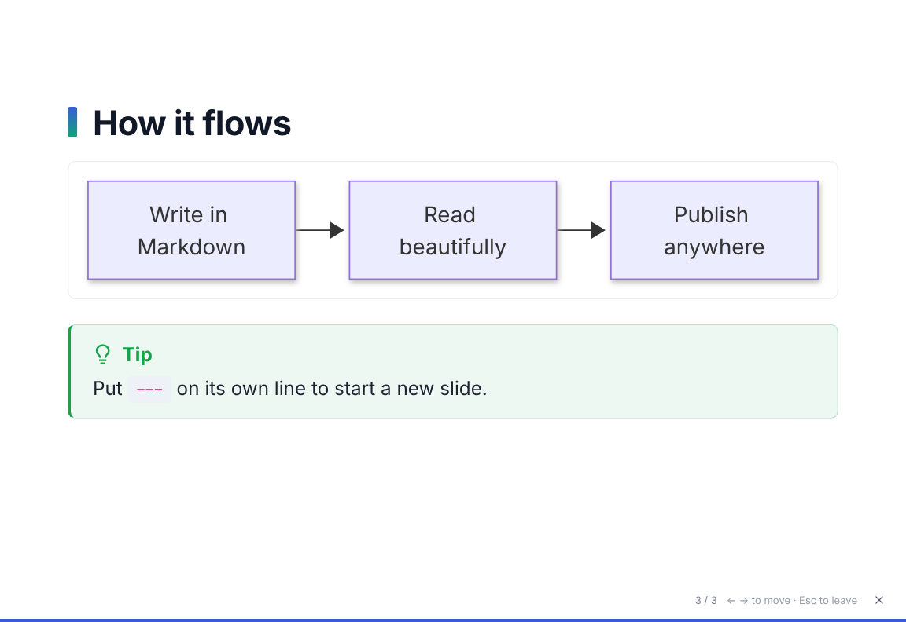

- **Customize theme** (*Preferences → Appearance*, or *Customize colours & fonts…* in the theme menu):
  - Pick an accent colour and fonts for text, headings and code. They apply to every theme.
  - Pick your own panel and background colours. Text on the panels changes to stay readable, and High Contrast keeps its own.
  - Optionally choose a **brand stylesheet** (a `.css` file, such as a company house style).
  - Exports use the same look, so a PDF or web page matches what you see.

## Power features

### Run code blocks

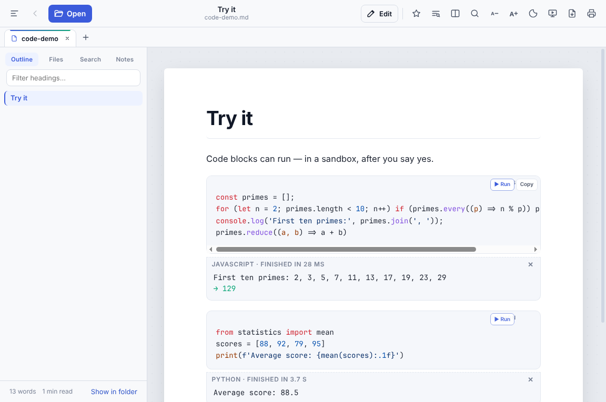

- JavaScript and Python code blocks get a **▶ Run** button, and the output appears under the block.
- **Nothing runs by itself.** Each run shows you the code and asks first. You can tick *Don't ask again
  for this document* until you close it.
- Code runs in a **sealed sandbox**: a separate hidden window with its own session. It can't read or
  change your files, use the network or see your settings, and it's stopped after 10 seconds
  (30 for Python).
- Python is the real thing ([Pyodide](https://pyodide.org)) with its standard library, built into the app.
- Shell, PowerShell and batch commands are never run.
- Turn the feature off entirely with the option in *Preferences → Editing*.

### Password-locked documents

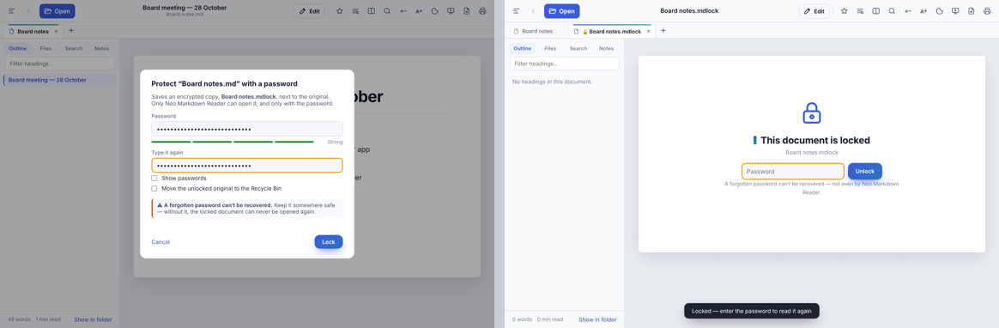

- **File → This Document → Protect with Password…** saves an encrypted copy (`notes.mdlock`) next to the original, using
  AES-256 with a key made from your password (scrypt). Only RT Markdown Reader can open it, and only
  with the password.
- The original stays unless you tick *Move the unlocked original to the Recycle Bin*.
- Opening a locked document asks for the password. After that it stays open until you quit or choose
  **File → This Document → Lock Now**.
- You can edit a locked document. Saving keeps it encrypted.
- **File → Save an Unlocked Copy…** writes a normal `.md` where you choose.
- Locked documents are never searched, highlighted or sent to AI assist, so their text is never stored
  anywhere unencrypted.
- **A forgotten password can't be recovered.** That is what makes the lock real.

### AI assist (optional)

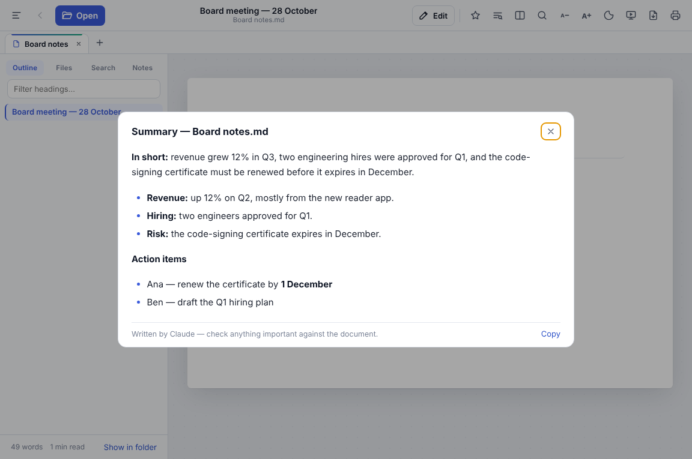

- *Edit → AI Assist* offers:
  - **Summarize Document**
  - **Explain Selection** (in plain language)
  - **Turn Notes into a Report**, which opens the draft as a new document.
  - **Draft Flashcards**, from the whole document, one chapter or the selected text. You tick the ones to add.
  - **Ask About This Folder…** (2.3) and **Proofread, Rewrite, Shorten** or **Translate** a selection in
    the editor (2.4; see [AI writing help](#read-listen--share)).
- It uses the service you choose (since 3.3): Claude, ChatGPT, Gemini, Mistral, OpenRouter, or a model on
  your own computer ([details](#your-ai-your-choice)), with **your own key**. It's off until you turn it on in
  *AI Assist Settings…*, and requests are billed to your account with that service.
- With Claude, choose Opus 5.5 (the default), Sonnet 5.5 or Haiku 5.5. Answers stream in as they're written.
- **Privacy:**
  - Nothing is sent until you pick a command.
  - Only that document, or that selection, is sent.
  - Locked documents are never sent.
- Your keys are encrypted by your operating system and never stored in the settings file.

### More colour themes

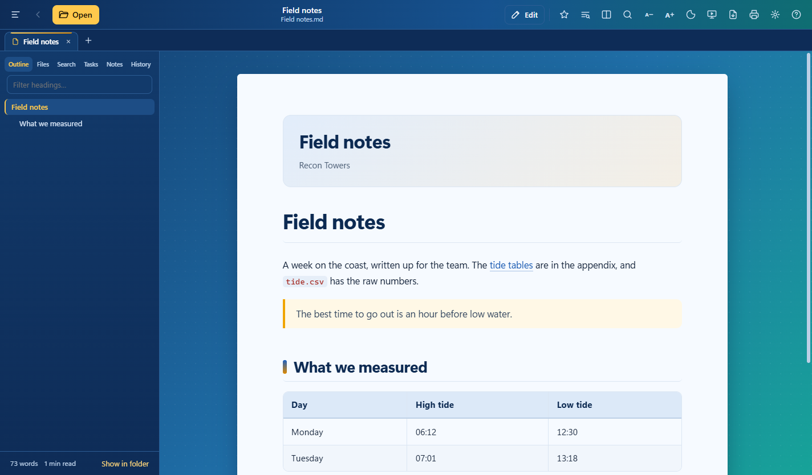

*New in 3.5:* **Blue**, **Red** and **Yellow** have panels that run from one colour to another, contrasting buttons and a
clean page to read on. The **Glass** look (the theme button, or *Preferences → Appearance*) works with any theme, turning
its panels and page to frosted glass over its own colours. It's left out of High Contrast, printing and exports, and
it steps aside if your computer is set for less transparency.

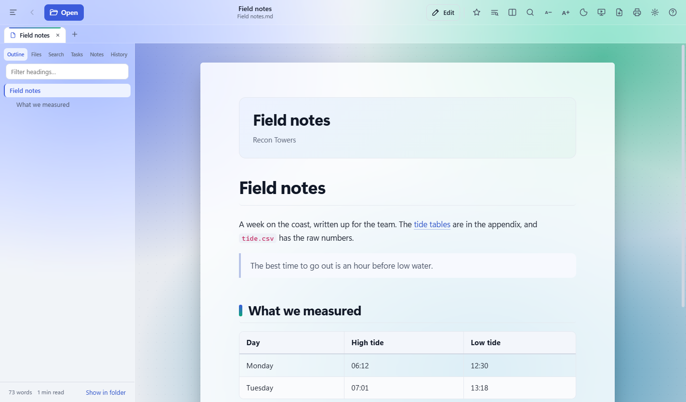

**Colour-safe colours** (*Preferences → Appearance*) work with any theme, for protanopia, deuteranopia and tritanopia.
Compare shows changes in blue and orange instead of green and red, with underlines and strikethroughs so they don't
rest on colour alone, and charts and highlights change to colours that stay different. Exported files keep the normal colours.

The same button has fifteen fonts, including Times New Roman, Georgia and Century, for the page and its headings. Word and
PowerPoint exports use them too. A computer without a font uses the nearest match.

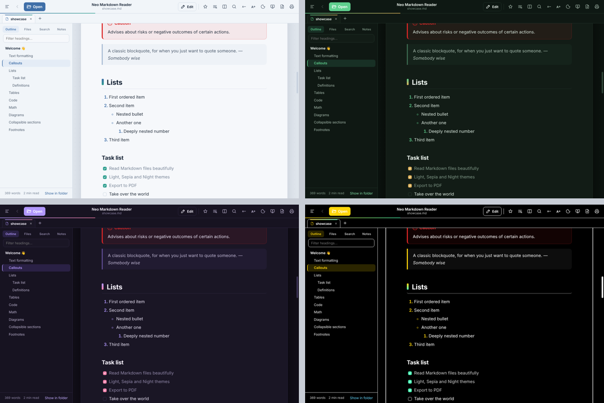

**Mist**, **Forest**, **Dusk** and **High Contrast** join Paper, Sepia and Night in the theme menu. They work
with your own accent colour and in exports.

## At home on Windows

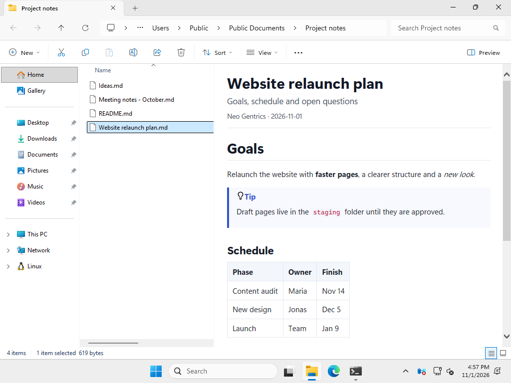

*File Explorer's Preview pane showing a `.md` file, captured on Windows 11.*

- **File Explorer preview.** Select a `.md` file in Explorer with the Preview pane on (`Alt+P`) to see it
  formatted, without opening the app. It follows Windows' light or dark mode.
  - The preview is a quick look: it doesn't load images from the internet and doesn't run anything.
  - If another app already shows previews for `.md` files (PowerToys, for example), the installer leaves it
    in place.
  - Uninstalling the app removes the preview.
- **Accessibility:**
  - Every screen and dialog is checked automatically with [axe](https://github.com/dequelabs/axe-core) in
    all ten themes and in Windows high-contrast mode.
  - Text meets WCAG AA contrast.
  - Tabs, the sidebar and Quick Open work from the keyboard and are announced properly by screen readers.
  - Focus is always visible, and animations stop when Windows' *Animation effects* setting is off.

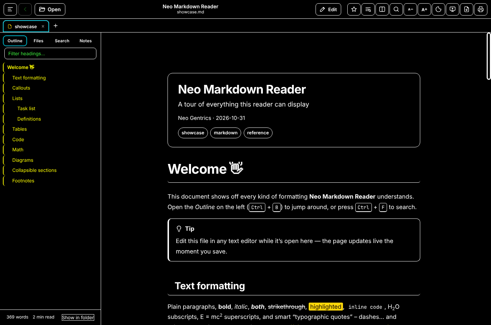

*In Windows high-contrast mode the app uses the system colours, and the keyboard focus is always outlined.*

- **More ways to install:**
  - A Linux `.deb` package.
  - A Mac build for Intel Macs as well as Apple silicon.
  - The Windows Package Manager (`winget`): 3.2.0 has been submitted
    ([microsoft/winget-pkgs#469811](https://github.com/microsoft/winget-pkgs/pull/469811)) and is
    waiting for Microsoft's review. Once it's accepted:

    ```bash
    winget install NeoGentrics.NeoMarkdownReader
    ```

## Keyboard shortcuts

| Keys | Action |
|---|---|
| `Ctrl` `O` | Open file (in a new tab) |
| `Ctrl` `Tab` / `Ctrl` `Shift` `Tab` | Next / previous tab |
| `←` `→` `Home` `End` / `Delete` (on a tab) | Move between tabs / close the tab |
| `Ctrl` `1` … `Ctrl` `9` | Jump to a tab |
| `Ctrl` `W` / `Ctrl` `Shift` `T` | Close tab / reopen closed tab |
| `Ctrl` + click a link | Open the linked document in a new tab |
| `Ctrl` `Shift` `C` | Copy as formatted text |
| `Ctrl` `F` | Find in document |
| `Ctrl` `B` | Show / hide the sidebar (when not editing) |
| `Ctrl` `=` / `Ctrl` `-` / `Ctrl` `0` | Bigger / smaller / reset text |
| `Ctrl` `Shift` `E` | Export as PDF (the PDF designer) |
| `Ctrl` `Shift` `P` | Present as slides (`←` `→` to move, `Esc` to leave) |
| `Ctrl` `P` | Print |
| `F5` | Reload file |
| `Alt` `←` | Back to the previous document |
| `Ctrl` `K` | Go to a file, `#` + text to jump to a heading, or `>` to run a command |
| `Ctrl` `Shift` `O` / `Ctrl` `Shift` `F` / `Ctrl` `Shift` `R` | Open folder / find in folder / replace in folder |
| `Ctrl` `Shift` `Y` | Version history of this document |
| `F2` | Rename the document (and update links to it) |
| `Ctrl` `Shift` `U` / `F8` | Read aloud / focus mode |
| `Ctrl` `Shift` `[` / `Ctrl` `Shift` `]` | Fold / unfold all sections |
| `Ctrl` `Shift` `L` / `Ctrl` `Shift` `M` / `Ctrl` `Shift` `D` | Tasks panel / link map / today's note |
| `[[` (while editing) | Link to another document in the folder |
| `Ctrl` `Shift` `K` | Find a command by name |
| `Ctrl` `Shift` `V` | Paste as plain text (while editing) |
| `Ctrl` `\` | Split view |
| `Ctrl` `Shift` `H` / `Ctrl` `D` | Highlight selection / bookmark this file |
| `Ctrl` `N` | New document |
| `Ctrl` `E` | Edit / finish editing |
| `Ctrl` `S` / `Ctrl` `Shift` `S` | Save / Save As |
| `Ctrl` `B` · `Ctrl` `I` · `Ctrl` `K` | Bold · italic · link (while editing) |
| `Ctrl` `Z` / `Ctrl` `Y` | Undo / redo (while editing) |
| `Ctrl` `Shift` `N` / `Ctrl` `Shift` `W` | New window / close window |
| `F1` | Keyboard shortcuts |

On macOS use `Cmd` instead of `Ctrl`. Any of these can be changed under *Preferences → Shortcuts*.

## Roadmap

- **v1.1** added tabs, a proper menu bar, session restore, automatic updates, an image viewer and rich copy.
- **v1.2** added new documents, templates and editing with a permission step.
- **v1.3** added folders, search across files, Quick Open, split view, Compare,
  highlights, notes and bookmarks.
- **v1.4** added a PDF designer with cover and contents pages, Word, web page and text
  export, presentation mode, and custom colours, fonts and brand stylesheets.
- **v2.0** added running code blocks in a sandbox, password-locked documents, optional AI
  assist with Claude, and four more colour themes.
- **v2.1** added a formatted preview in File Explorer, an accessibility pass, more ways to install
  (Linux `.deb`, Intel Mac, `winget`), and builds that are signed as soon as a code-signing
  certificate is added.
- **v2.2** added pasted and dropped pictures, a table editor (with paste from Excel), paste from Word
  and web pages as clean Markdown, Word import, version history, replace across a folder, and running
  any command from Quick Open with your own shortcuts.
- **v2.3** added `[[wiki links]]` (suggested as you type, updated when you rename), backlinks, a link map,
  tags, a Tasks panel with daily notes, a link checker, and (optionally) asking Claude about a folder.
- **v2.4** added read aloud, focus mode, folding sections, hover previews, CSV / JSON / YAML / Jupyter
  notebook files, charts from data, EPUB and PowerPoint export, and (optionally) AI writing help in the editor.
- **v3.0** added the app in Spanish, French and German, right-to-left documents, and add-ons (new code-block
  types, export formats and colour themes, each approved by you and run in a sealed sandbox).

- **v3.1** added sync between your computers: highlights, notes, bookmarks, recent files, reading positions
  and settings, through a folder you already sync, with no account.
- **v3.2** added natural voices for Read aloud: ten natural-sounding voices in 31 languages that run on your
  computer, offline, downloaded once when you ask.
- **v3.3** added more AI services: ChatGPT, Gemini, Mistral and OpenRouter as well as Claude, each with your own
  key, or a private model on your own computer (Ollama, LM Studio), plus a quicker model for writing help.
- **v3.4.1** took the name RT Markdown Reader, connected Claude Desktop and Claude Code to your documents, and added
  a hands-on tutorial, the Help Center and one Preferences window, with shorter menus.
- **v3.5** added MP3 and audiobook export, a pronunciation list, offline dictation, a choice of speakers and
  microphone, read aloud in presentation mode, a read-aloud bar you can see and move, Blue, Red and Yellow themes,
  a Glass look, colour-safe colours and fifteen fonts.
- **v3.6** added search by meaning with related documents, citations and reference lists, flashcards and quizzes,
  links with other Recon Towers apps, richer colours for the older themes, and more choices in Customize Theme.
- **v3.7** added automations: your webhooks as commands, your n8n workflows by name, and an address your workflows can
  call to open documents.
- **v3.8** added Notion: pages in as Markdown and databases as tables, documents sent back with only your changes, and a
  note when a linked page has moved on.

Coming next:
- **v3.9 — Your home server:** open and save documents on Nextcloud or any WebDAV server, and publish to
  self-hosted wikis (BookStack, Wiki.js, Outline).
- **v3.10 — Publish anywhere:** send a document as a WordPress or Ghost draft, or share it to Discord.
- **v4.0 — Writing studio:** book projects exported as EPUB, print-ready PDF and Word, Git built in,
  a folder published as a website, and an add-on gallery.
- **Later, if needed:** shared review, a phone companion, writing together live.

Signed installers follow as soon as a code-signing certificate is bought.

**[See the full roadmap →](ROADMAP.md)**

## Building from source

The source is public for reference. Building it for your own use or redistribution requires
permission (see [License](#license)).

Requirements: **Node.js 22** (see `.nvmrc`) and Git. Building the Windows installer also needs the
**.NET 8 SDK** and **Visual Studio or its Build Tools with "Desktop development with C++"**, for the
File Explorer preview add-on.

```bash
npm ci                 # install dependencies
npm run dev            # build the UI and launch the app with the feature showcase
npm test               # unit tests (Markdown pipeline, files, settings, editing permissions & saving)
npm run test:e2e       # launches the real app and drives it (reading, tabs, editing, folders, compare, highlights)
npm run test:preview   # File Explorer preview renderer tests (.NET 8 SDK)
npm run dist:win       # Windows installer (with the Explorer preview) + portable .exe → release/
npm run dist:mac       # macOS .dmg for Apple silicon and Intel (run on a Mac)        → release/
npm run dist:linux     # Linux AppImage + .deb                                         → release/
npm run icons          # regenerate build/icon.png + icon.ico from build/icon.svg (needs Playwright)
```

The Windows installer is built on Windows: the Explorer preview add-on is a .NET Framework library plus
a small native COM server that Windows loads it through.

## How it works

```
src/
├── main/                 Electron "main" process (Node.js, talks to the OS)
│   ├── main.js           windows, tabs bookkeeping, menus, file opening, live reload, sessions, links
│   ├── publish.js        exports: the PDF designer's pages, web pages, Word documents (runs hidden, script-free windows)
│   ├── export-tools.js   PDF finishing (pdf-lib), .docx (docx), .epub (fflate) and .pptx (pptxgenjs), bundled into dist/export-tools.cjs
│   ├── editing.js        edit permission, saving, backups, conflict checks (the only code that writes files)
│   ├── locked.js         password-locked documents: AES-256-GCM with a scrypt key
│   ├── sandbox.js        the sealed code sandbox (own session, private scheme, every other request refused)
│   ├── ai.js             AI assist prompts and the Claude request (official Anthropic SDK)
│   ├── ai-providers.js   other AI services and local models: settings, model lists, streaming requests
│   ├── notes-core.js     wiki links, backlinks, tags, tasks, link checking and rename rewrites (pure functions, shared with the page)
│   ├── folder-index.js   the open folder's links, tags and tasks, re-reading only files that changed
│   ├── data-docs.js      CSV / TSV, JSON, YAML and Jupyter notebooks as read-only Markdown
│   ├── i18n.js           translations: picks the language, translates menus and native dialogs
│   ├── addons.js         add-ons: checks manifests and packages, installs them, theme CSS, the sandbox program
│   ├── folders.js        scanning and searching an opened folder
│   ├── annotations.js    private highlights & notes (stored in app data, never in the file)
│   ├── flashcards.js     finds cards in a document, and works out when each comes back
│   ├── bibliography.js   reads sources from BibTeX, CSL JSON and Zotero
│   ├── automations.js    your webhooks as commands, and your n8n workflows by name
│   ├── inbound.js        the key-protected address workflows can call
│   ├── smart-search.js   smart search: the verified download, and talking to its process
│   ├── smart-worker.js   that process: reads a folder for meaning (bundled into dist/)
│   ├── smart-core.js     passages, the tokenizer, and the index of vectors
│   ├── sync.js           sync between computers: one file per computer in a synced folder, newest item wins
│   ├── voices.js         natural voices: the pinned, checksummed download, and the process that speaks
│   ├── voice-worker.js   that process: Supertonic 3 on ONNX Runtime's WebAssembly engine (bundled into dist/)
│   ├── supertonic.js     the model's four networks, run sentence by sentence
│   ├── pronounce.js      the pronunciation lists
│   ├── dictation.js      dictation: the pinned, checksummed download, and the process that listens
│   ├── dictate-worker.js that process: Whisper on ONNX Runtime's WebAssembly engine (bundled into dist/)
│   ├── whisper.js        turning sound into what Whisper reads, and its words back into text
│   ├── voice-text.js     text preparation, sentence chunks and language guessing (shared with the page)
│   ├── (help/*.md at the top of the repo are the Help Center's guides)
│   ├── connector.js      the Claude connector: what Claude can reach, and adding it to Claude's apps
│   ├── connector-bridge.js  the program Claude starts: MCP on stdin and stdout
│   ├── claude-code.js    AI assist and Open Folder through Claude Code
│   ├── updater.js        update checks against GitHub Releases (electron-updater for the installer)
│   ├── version.js        version comparison
│   ├── files.js          which files can be opened + reading them safely
│   ├── settings.js       validated user settings (theme, font, recent files, session, reading positions…)
│   └── preload.js        the small, explicit API the page may call (contextBridge)
└── renderer/             The page you see (runs in a locked-down Chromium sandbox)
    ├── markdown.js       Markdown → sanitized HTML (markdown-it + plugins, DOMPurify)
    ├── app.js            tabs, toolbar, outline, find, drag & drop, image viewer, Mermaid rendering
    ├── editmode.js       edit mode: editor beside the live preview, save / save as, new documents
    ├── editor-entry.js   the CodeMirror 6 editor (loaded only when you edit)
    ├── templates.js      File → New from Template
    ├── sidebar.js        Outline · Files · Search · Tasks · Notes · History panels
    ├── notes-ui.js       Backlinks, tag chips, the Tasks panel, the link map, the link checker and Rename
    ├── read-ui.js        read aloud, focus mode, folding sections and hover previews
    ├── charts.js         ```chart blocks and charted tables, drawn as SVG
    ├── i18n-ui.js        translates the page's own text (never the document) as it appears
    ├── addons-ui.js      the Add-ons window, add-on code blocks, themes and exports
    ├── palette.js        Quick Open (Ctrl+K)
    ├── split.js          split view and linked scrolling
    ├── compare.js        line and word diffs for Compare
    ├── highlights.js     finding and drawing highlights on the page
    ├── publish-ui.js     the PDF designer dialog and File → Export
    ├── export-model.js   the page as a simple document model (for Word and plain text)
    ├── present.js        presentation mode (slides split on ---)
    ├── brand.js          custom accent colour and fonts as CSS
    ├── theme-ui.js       Customize Theme
    ├── lock-ui.js        the unlock screen and Protect with Password
    ├── run-ui.js         ▶ Run buttons and output panels
    ├── ai-ui.js          AI assist settings and the answer panel
    ├── index.html        layout + Content-Security-Policy
    └── styles/           themes, document typography, code colors, print/PDF, export & presentation styles
├── sandbox/              The code sandbox's page and worker (plus Pyodide, copied in at build time)
└── locales/              es.json, fr.json, de.json, built from the tables in locales/source/*.tsv
preview/                    File Explorer preview: a COM preview handler (C#, .NET Framework 4.8, Markdig) + tests;
                            preview/shim is the native COM server (C++) Windows starts it through
build/installer.nsh         installer steps: registers the Explorer preview for the current user
scripts/winget-manifest.mjs writes the winget manifests for a release
scripts/build-renderer.mjs  bundles the renderer into dist/ with esbuild
scripts/i18n-build.mjs      builds src/locales/*.json from the translation tables
scripts/i18n-strings.mjs    lists the app's English text; --missing shows what isn't translated yet
samples/showcase.md         feature tour (Help → Open Feature Showcase)
samples/addons/neo-extras/  a sample add-on: timeline blocks, an OPML export and the Solar theme
test/                       node:test suites (run under jsdom)
```

**Rendering pipeline:** the file is read by the main process, sent to the page, parsed by
**markdown-it** (GitHub-flavored, with plugins for callouts, footnotes, math, emoji and more),
highlighted by **highlight.js**, sanitized by **DOMPurify**, and then decorated in the page (Mermaid
diagrams, copy buttons, outline). Relative image paths are resolved against the document's folder,
so pictures next to your `.md` file just work.

**Security model:** Markdown files can contain HTML. The reader keeps the parts that make documents
look good (colors, alignment, images, tables, `<details>`) and removes anything that could run code:
`<script>`, event handlers like `onclick`, `<iframe>`, forms and `javascript:` links. The page runs
with `sandbox`, `contextIsolation` and no Node.js access, under a strict Content-Security-Policy.
Clicking a link never executes a file: Markdown links open in the reader, web links open in your
browser, and any other local file is only *shown in its folder*. The page itself can never write a
file: saving is done by the main process, only for files you allowed, after a native permission prompt
the page can't fake. Code blocks only ever run after you confirm, in a separate sandbox with no file,
network or settings access. Add-ons are installed only after you approve what they add; their code runs in
that same sandbox, and what they draw is sanitized like a document. See [SECURITY.md](SECURITY.md).

## Releasing

1. Bump `version` in `package.json`, and update the docs for every release:
   - [CHANGELOG.md](CHANGELOG.md): a new entry.
   - This README: features table, feature sections, shortcuts, screenshots, the Roadmap summary and "How it works".
   - [ROADMAP.md](ROADMAP.md): mark what shipped and what's next.
2. Commit, then tag and push:
   ```bash
   git tag v1.0.0 && git push origin v1.0.0
   ```
   Or, without a tag: **Actions → Release → Run workflow**. It tags the current commit as
   `v<version>` from `package.json`.
3. The **Release** workflow builds Windows, macOS and Linux apps and publishes them to GitHub Releases.
4. Optional, after it's published:
   - **winget:** run `node scripts/winget-manifest.mjs`, check the folder it writes with
     `winget validate --manifest <folder>`, then submit it to
     [microsoft/winget-pkgs](https://github.com/microsoft/winget-pkgs) as
     `manifests/n/NeoGentrics/NeoMarkdownReader/<version>/`, for example with `wingetcreate submit`.
     The manifests use the 1.12 schema.
   - **Code signing:** add `WINDOWS_CSC_LINK` (the `.pfx` certificate, base64-encoded) and
     `WINDOWS_CSC_KEY_PASSWORD` as repository secrets. Every later release is then signed automatically,
     and the Release log reports the signature status.

Every push and pull request runs the **CI** workflow: tests on Windows, macOS and Linux, plus a
downloadable Windows build under the run's *Artifacts*.

## License

**Proprietary. All rights reserved.** © 2026 Recon Towers.

The source code is visible for reference only. You may download and use the official releases. You
may **not** copy, modify, redistribute or reuse the code, in whole or in part, without written
permission. See [LICENSE](LICENSE) for the full terms and [THIRD_PARTY_NOTICES.md](THIRD_PARTY_NOTICES.md)
for the open-source components the app is built on.

For licensing enquiries: **author@neogentrics.com**

---

<div align="center">


**Recon Towers Dev Department**

[recontowers.com](https://recontowers.com) &nbsp;·&nbsp; [This app on the Bench](https://recontowers.com/projects/neo-markdown-reader/) &nbsp;·&nbsp; [Report a problem](https://github.com/neogentrics/rt-markdown-reader/issues/new/choose)

<sub>© 2026 Recon Towers. All rights reserved.</sub>

</div>
