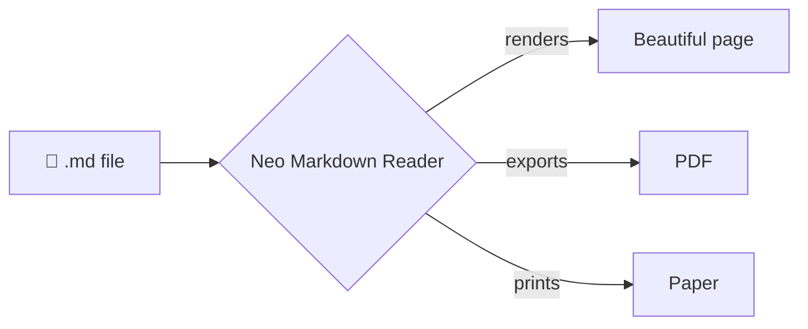
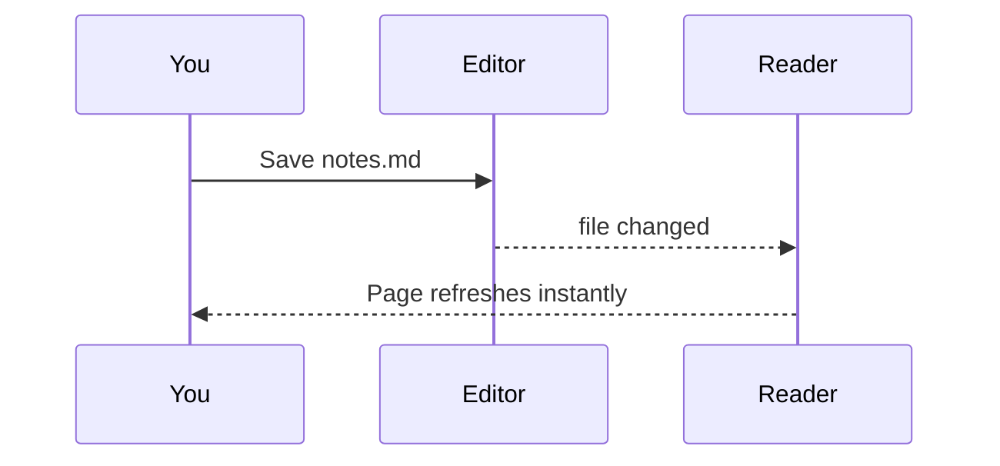

# Welcome :wave:

This document shows off every kind of formatting **Neo Markdown Reader** understands. Open the
*Outline* on the left (<kbd>Ctrl</kbd> + <kbd>B</kbd>) to jump around, or press <kbd>Ctrl</kbd> + <kbd>F</kbd> to search.

> [!TIP]
> Edit this file in any text editor while it's open here — the page updates live the moment you save.

## Text formatting

Plain paragraphs, **bold**, *italic*, ***both***, ~~strikethrough~~, ==highlighted==, `inline code`,
H~2~O subscripts, E = mc^2^ superscripts, and smart "typographic quotes" -- dashes... and ellipses.
Bare links become clickable: https://github.com — and so do [regular links](https://www.markdownguide.org "Markdown Guide").

<p align="center">
  <span style="color:#e03131;font-weight:700">Colored</span> ·
  <span style="color:#2f9e44;font-weight:700">inline</span> ·
  <span style="color:#1971c2;font-weight:700">HTML</span> ·
  <span style="background:#fff3bf;color:#5c3c00;padding:2px 8px;border-radius:6px">badges</span> ·
  <font color="#ae3ec9"><b>&lt;font&gt; tags</b></font>
</p>

## Callouts

> [!NOTE]
> Useful information that users should know, even when skimming content.

> [!IMPORTANT]
> Key information users need to know to achieve their goal.

> [!WARNING]
> Urgent info that needs immediate user attention to avoid problems.

> [!CAUTION]
> Advises about risks or negative outcomes of certain actions.

> A classic blockquote, for when you just want to quote someone.
> — *Somebody wise*

## Lists

1. First ordered item
2. Second item
   - Nested bullet
   - Another one
     1. Deeply nested number
3. Third item

### Task list

- [x] Read Markdown files beautifully
- [x] Light, Sepia and Night themes
- [x] Export to PDF
- [ ] Take over the world

### Definitions

Markdown
: A lightweight markup language for creating formatted text using a plain-text editor.

Reader
: The app you're looking at right now.

## Tables

| Feature            | Supported | Notes                                  |
| :----------------- | :-------: | -------------------------------------: |
| GitHub tables      |    ✅     |                   alignment respected   |
| Syntax highlighting|    ✅     |                     190+ languages      |
| Math (KaTeX)       |    ✅     |                     inline and display  |
| Mermaid diagrams   |    ✅     |          flowcharts, sequences, Gantt…  |
| Live reload        |    ✅     |                       on every save     |

## Code

```python
from dataclasses import dataclass

@dataclass
class Invoice:
    customer: str
    amount: float
    paid: bool = False

    def remind(self) -> str:
        """Friendly payment reminder."""
        return f"Hi {self.customer}, ${self.amount:,.2f} is due."  # f-strings!
```

```typescript
export async function fetchUser(id: number): Promise<User | null> {
  const res = await fetch(`/api/users/${id}`);
  return res.ok ? ((await res.json()) as User) : null;
}
```

```diff
- const theme = "plain";
+ const theme = "beautiful";
```

## Math

Inline math like $e^{i\pi} + 1 = 0$ sits right in the sentence. Display math gets its own line:

$$
\int_{-\infty}^{\infty} e^{-x^2}\,dx = \sqrt{\pi}
\qquad
\sum_{n=1}^{\infty} \frac{1}{n^2} = \frac{\pi^2}{6}
$$

## Diagrams





## Collapsible sections

<details>
<summary>Click to expand</summary>

Hidden content can contain **any** Markdown, including lists:

- one
- two

</details>

## Footnotes

Footnotes keep the text clean.[^1] You can have as many as you like.[^note]

[^1]: This is the first footnote.
[^note]: And this one has a name instead of a number.

---

<div align="center">

Made with :heart: by **Neo Gentrics**

</div>
